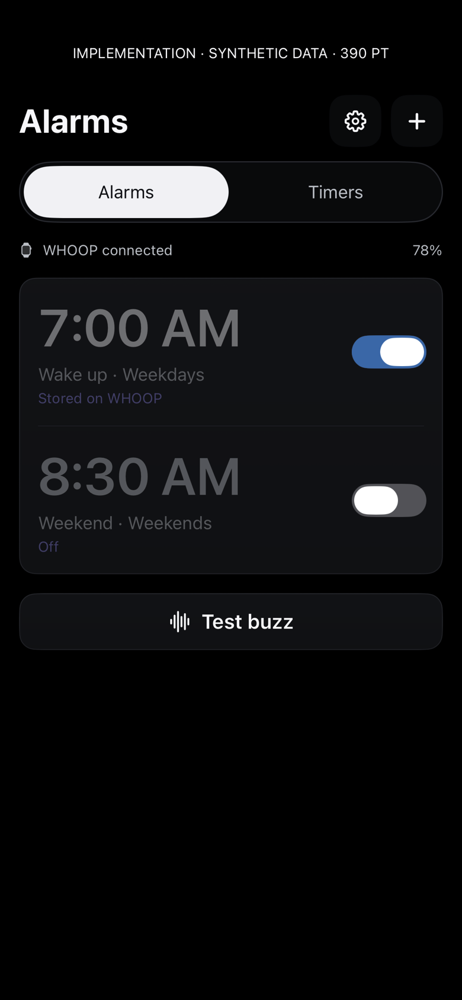
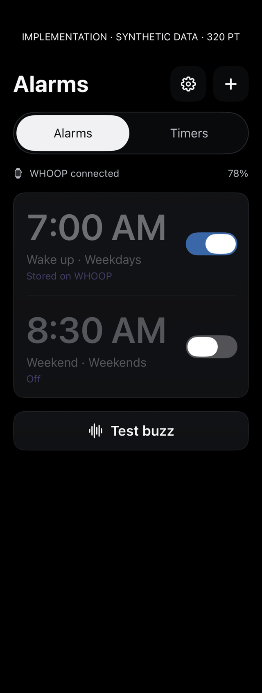
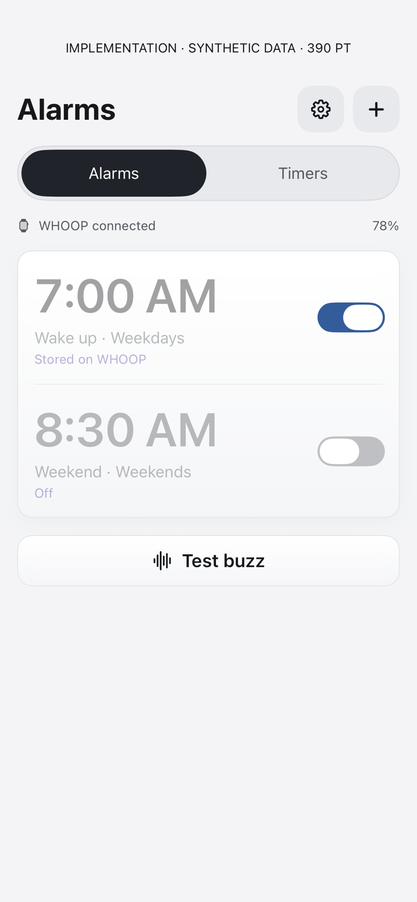
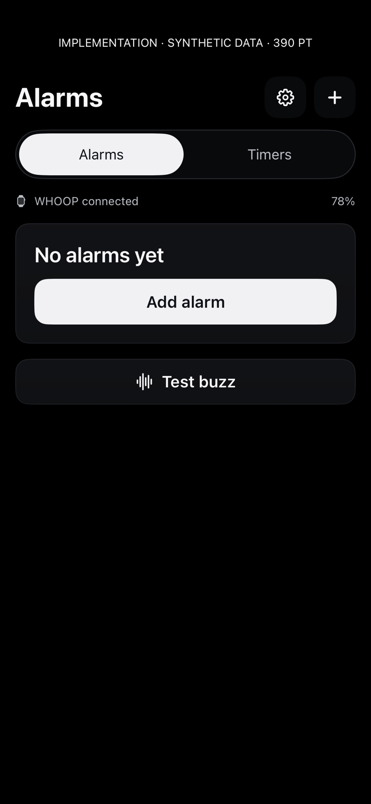
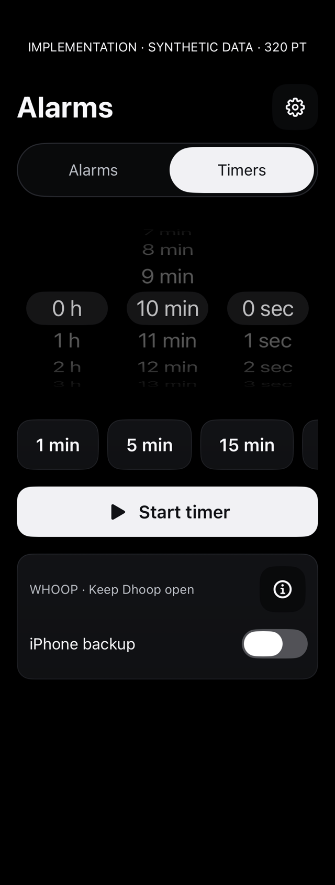
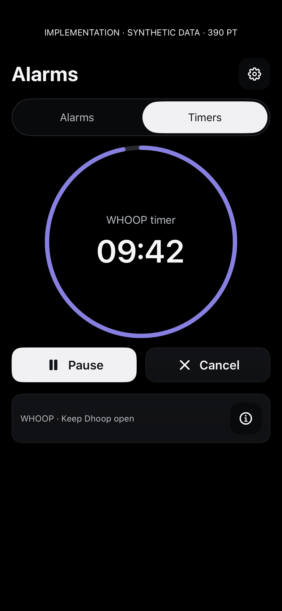
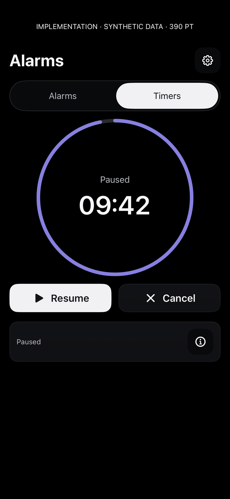
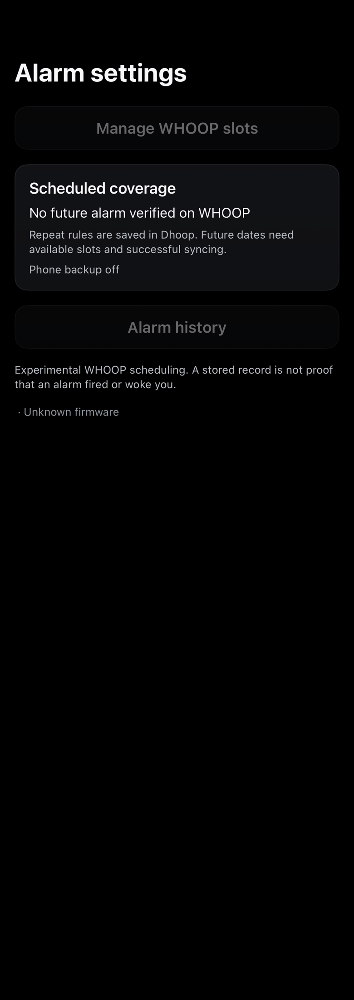

# Alarms and timers — initial build 518 implementation renders

Actual native components rendered on the physical iPhone with synthetic data. Click images for full size. These are content renders, not system chrome or gesture tests. No owner alarms or credentials are displayed and the fake coordinator cannot transmit BLE.

The initial Alarms and settings fixtures lacked a NavigationStack, so navigation links appear disabled/gray in this gallery. This is a fixture limitation; build 519 fixes the Alarms capture context. Preserve these initial captures for comparison, not as proof of the final enabled-link appearance. The main app already supplies its navigation stack. The [generated mockup](../../dhoop-alarm-timer-study.png) is a separate design reference.

Repeatable bounded capture:

```sh
Tools/capture-dhoop-alarm-timer-ui.sh CORE_DEVICE_ID docs/design/alarm-timer-implementation/NEW_VERSION
```

## Alarms · 390 pt · dark

[](alarms-390-dark.png)

## Alarms · 320 pt · narrow dark

[](alarms-320-dark.png)

## Alarms · 390 pt · light

[](alarms-390-light.png)

## Alarms · empty · 390 pt

[](alarms-empty.png)

## Timer setup · 390 pt · dark

[](timer-idle-390.png)

## Timer setup · 320 pt · narrow

[](timer-idle-320.png)

## Timer setup · 390 pt · light

[](timer-idle-light.png)

## Running countdown · 390 pt

[](timer-running.png)

## Running countdown · accessibility size 3 · 390 pt

[](timer-accessibility.png)

## Paused countdown · 390 pt

[](timer-paused.png)

## Preserved unreadable storage · 390 pt

[](timer-storage-error.png)

## Advanced settings · 390 pt

[](alarm-settings.png)

## Verification limits

Build 518 compiled for iOS and macOS; 34 timer, wake-alarm, and shared buzz tests passed. Build 519 later passed the combined 55-test Calendar/timer regression set and both app builds. Image content does not establish a real timer buzz, phone-lock behavior, successful Home Screen widget placement, or physical VoiceOver/touch behavior. No new timer vibration was wearer-confirmed. Foreground execution is required for dependable phone-managed countdown delivery; background is best effort. Existing wake-alarm configuration is separate.
