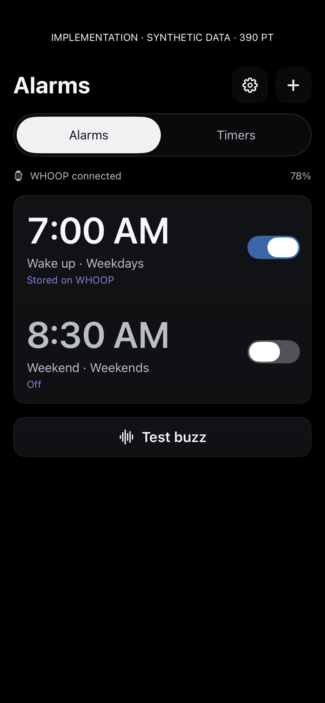
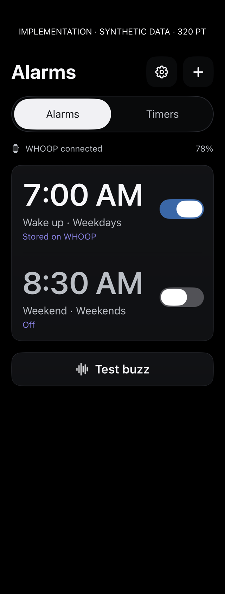
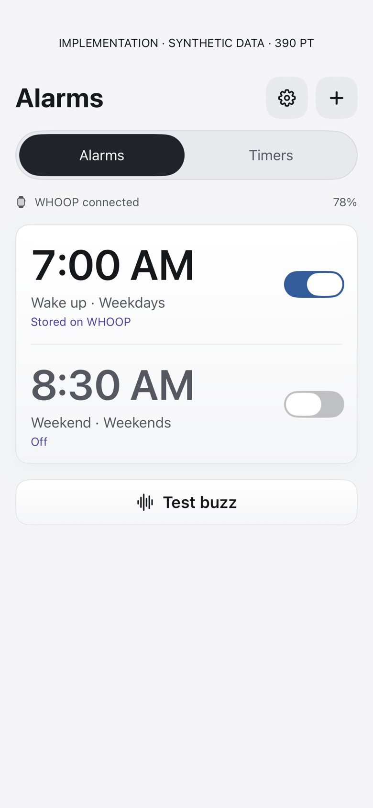
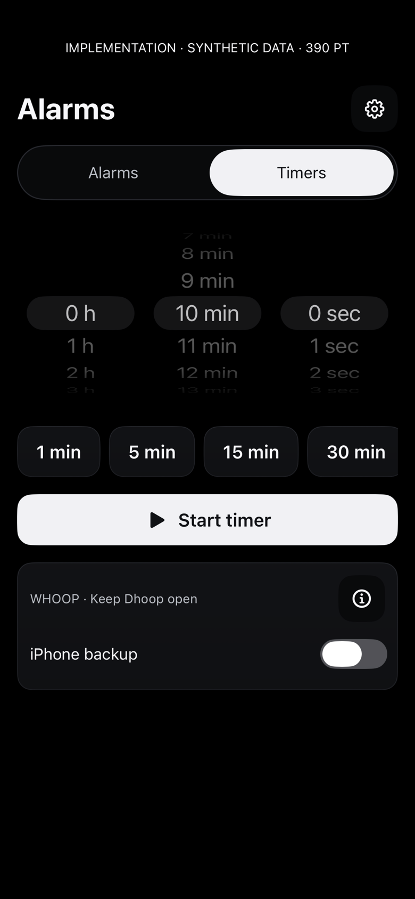
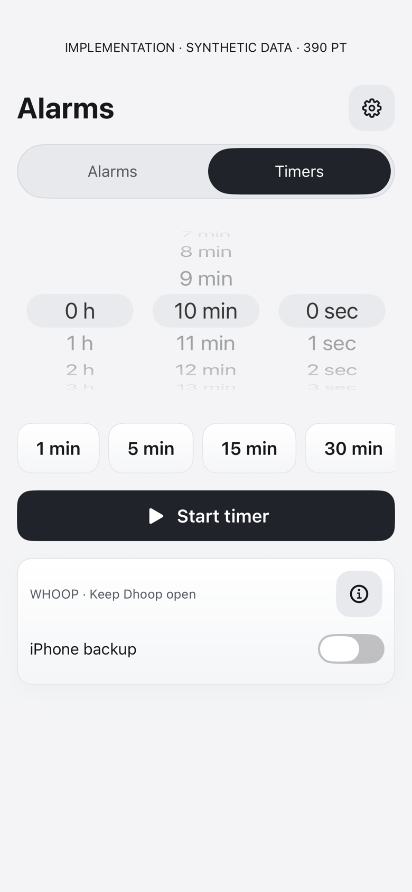
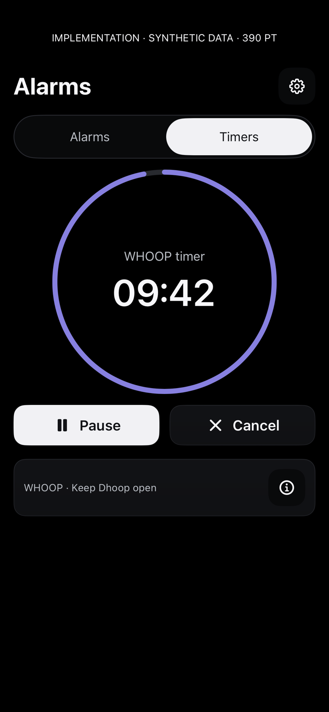
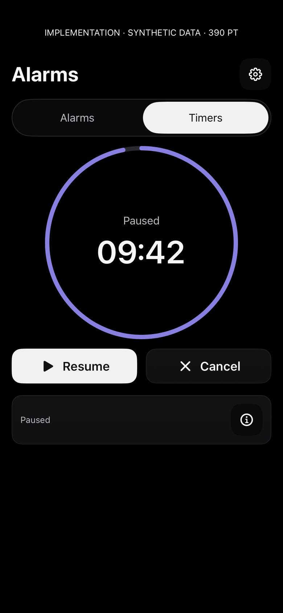
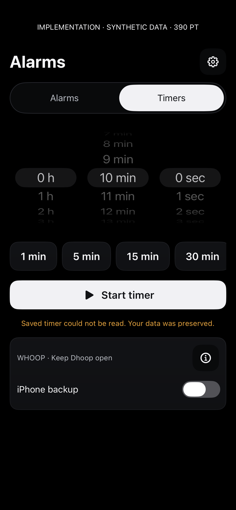
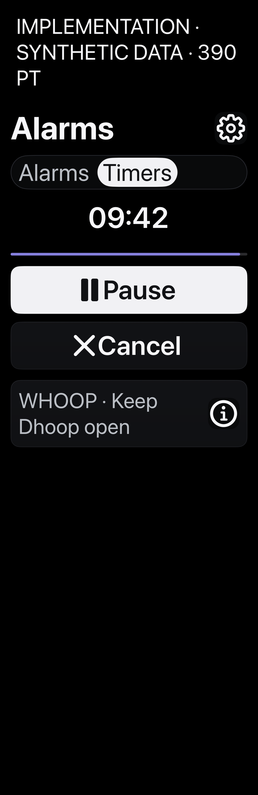

# Alarms and countdown timers

Actual SwiftUI components rendered on the physical iPhone with build 520, using synthetic data. Each image opens at full size. These are implementation renders, not design mockups or captures of iOS Home Screen chrome.

Repeat: `Tools/capture-dhoop-alarm-timer-ui.sh CORE_DEVICE_ID docs/design/alarm-timer-implementation/NEW_VERSION` with an unlocked paired phone. The script is bounded and checks a fresh run identity.

Fixtures use isolated state and no live calendar/nutrition transport or strap writes. They do not establish VoiceOver usability, gestures, actual notification/vibration delivery, or Home Screen placement.

## Alarms · dark · 390pt

## Alarms · narrow · 320pt

## Alarms · light · 390pt

## No alarms · 390pt

## Idle countdown · 390pt

## Idle countdown · 320pt

## Idle countdown · light

## Running countdown · 390pt

## Paused countdown · 390pt

## Storage error · 390pt

## Accessibility Dynamic Type · 390pt

## Settings fixture · 390pt

The settings fixture lacks its normal navigation container; muted navigation rows here do not establish their interactive appearance in the installed app. Countdown delivery is phone-managed; locked/suspended execution is best effort. No wake alarm is borrowed.
