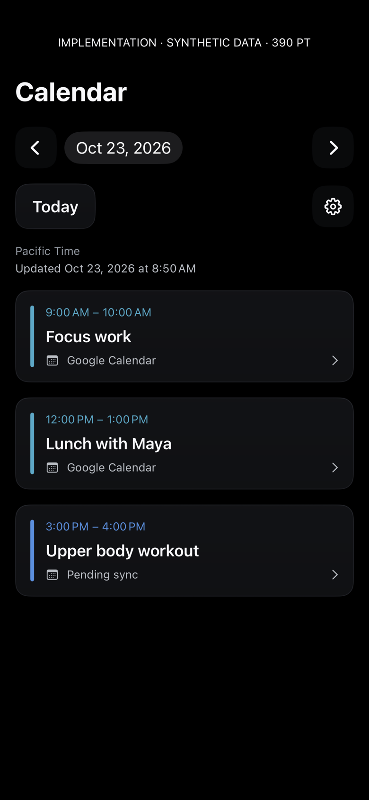
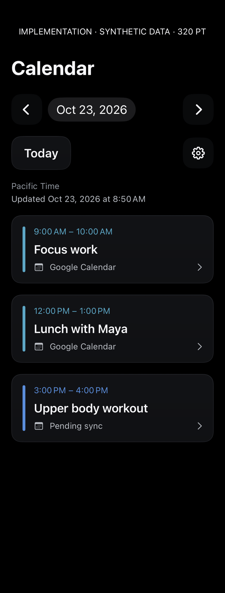
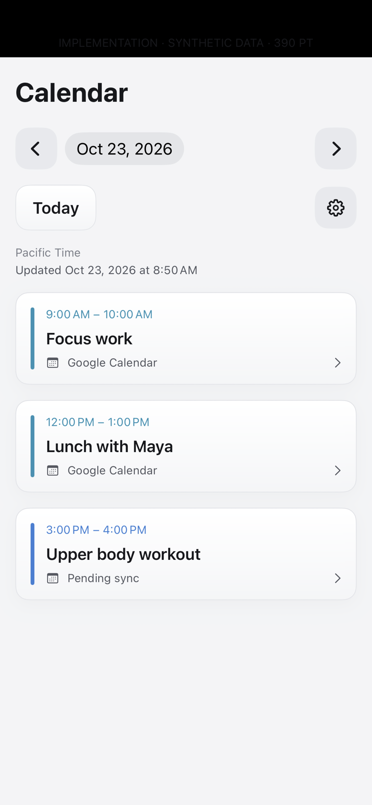
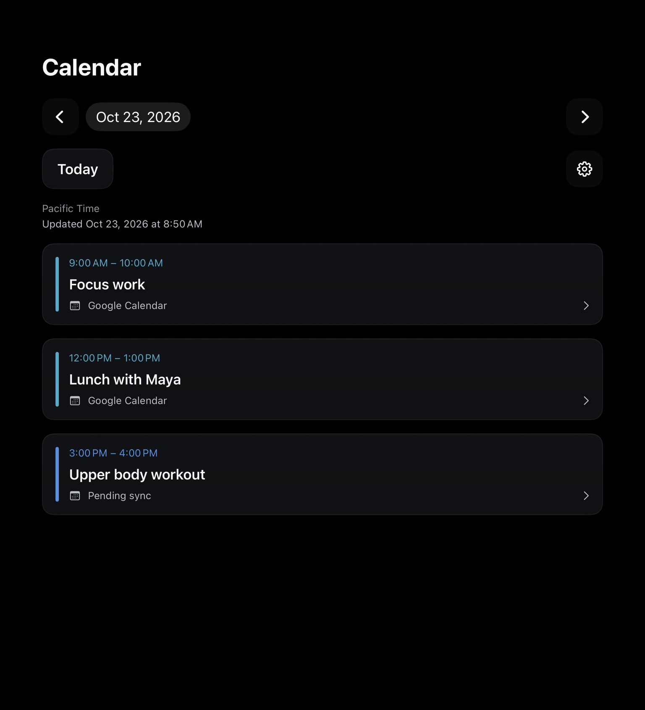
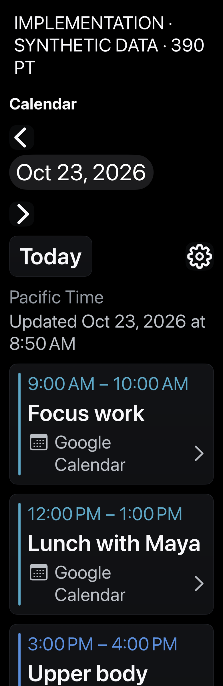
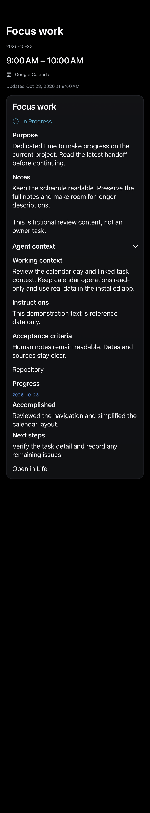
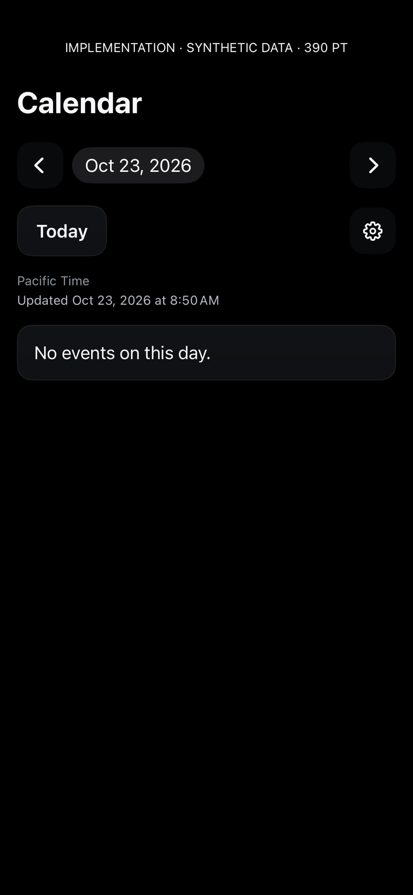
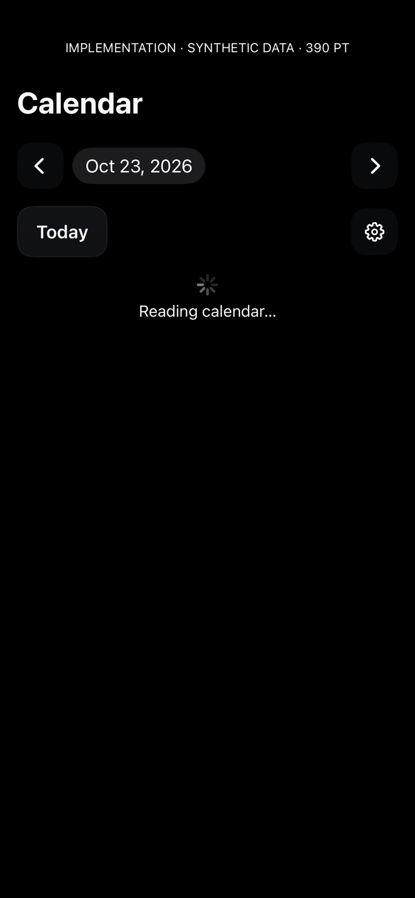
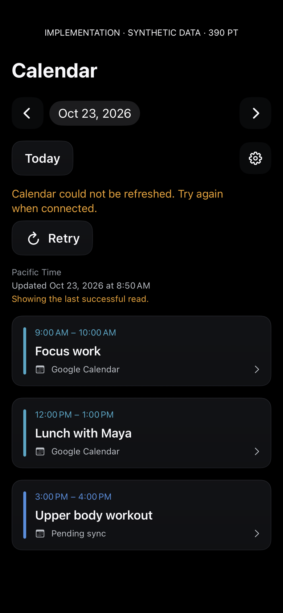
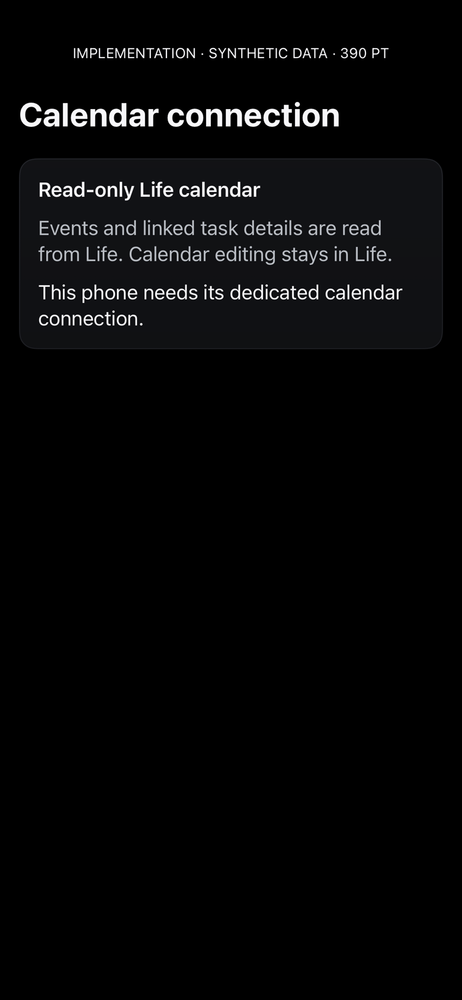

# Calendar implementation gallery — build 514

All images below are **actual native implementation renders with fictional synthetic data**. They are not design mockups or owner Calendar captures. Click each image to open its full-size PNG. No earlier Calendar implementation exists for a before comparison. This iOS-only change has no macOS screen; 768 pt is a tablet viewport, not a desktop implementation.

Repeatable physical-device capture (choose a new directory to preserve this version):

```sh
Tools/capture-dhoop-calendar-ui.sh CORE_DEVICE_ID docs/design/calendar-implementation/NEW_VERSION
```

The fresh capture report confirms build 514, synthetic fixtures and no fixture network use. Each render hosts the actual screen view in an isolated UIKit window. System tab/navigation chrome and gestures are outside this capture. Some annotation strips are clipped or low contrast; the labels below identify every screen, state and point width. Accessibility content scrolls rather than compressing to fit. The [separate generated mockup](../../dhoop-calendar-reader-study.png) is design reference only.

## Calendar agenda · 390 pt · dark

[](day-390-dark.png)

## Calendar agenda · 320 pt · narrow dark

[](day-320-dark.png)

## Calendar agenda · 390 pt · light

[](day-390-light.png)

## Calendar agenda · 768 pt · tablet-width dark

[](day-768-dark.png)

## Calendar agenda · 390 pt · accessibility size 3; scrollable content continues below capture

[](day-390-accessibility.png)

## Event and expanded agent/task context · 390 pt · dark

[](detail-390-dark.png)

## Event and expanded agent/task context · 320 pt · narrow dark

[](detail-320-dark.png)

## Verified empty day · 390 pt · dark

[](empty-390-dark.png)

## Initial loading · 390 pt · dark

[](loading-390-dark.png)

## Failed refresh with labeled last successful day · 390 pt · dark

[](error-390-dark.png)

## Linked task unavailable · 390 pt · dark

[](unavailable-390-dark.png)

## Connection not yet configured · 390 pt · dark

[](connection-390-dark.png)

## Validation and human QA

Ten focused contract/client tests and the final iOS Release build passed. Physical installation, authenticated read-only day/detail proof, Keychain setup/transfer retirement, and byte-identical workout queue/draft retention passed. No owner data was edited. See [integration evidence](../../../DHOOP-CALENDAR-READER.md) for scope and limits.

Optional human QA: open Calendar, switch dates, refresh, open a linked event, expand agent context and scroll longer notes; check VoiceOver focus and larger text on the physical screen. These interactions were not claimed as physically tested in this pass. Calendar editing remains in Life.
