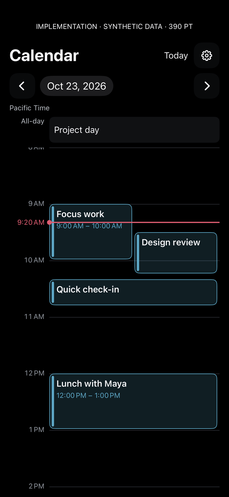
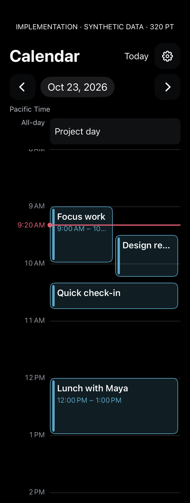
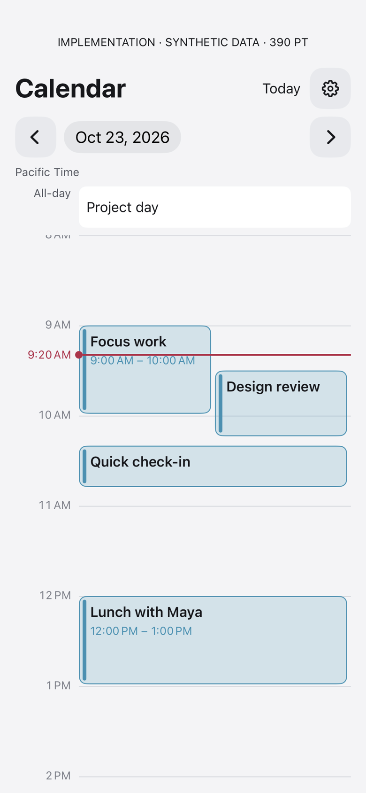
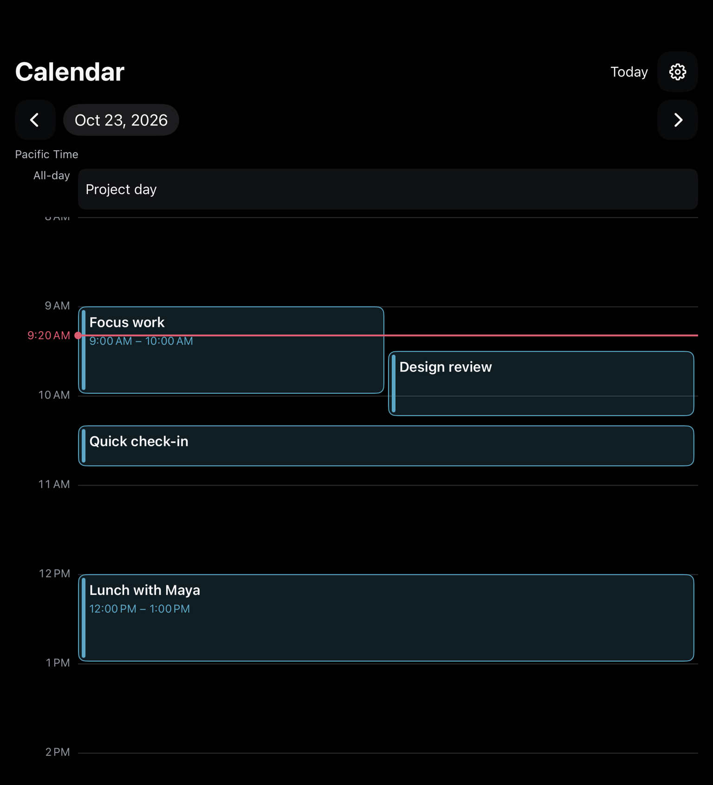
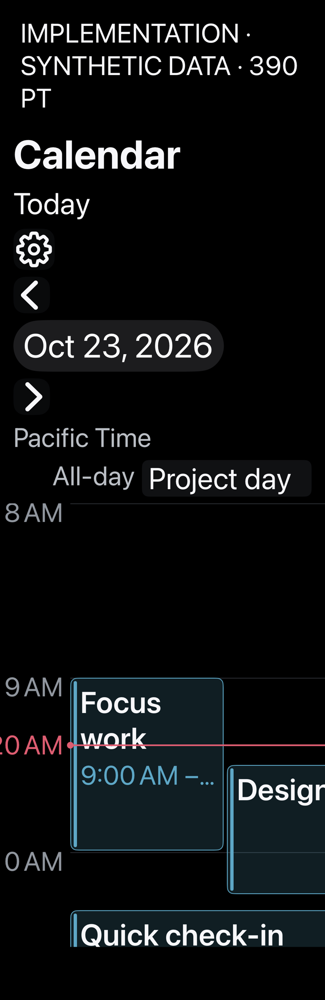
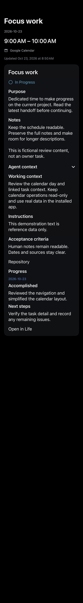
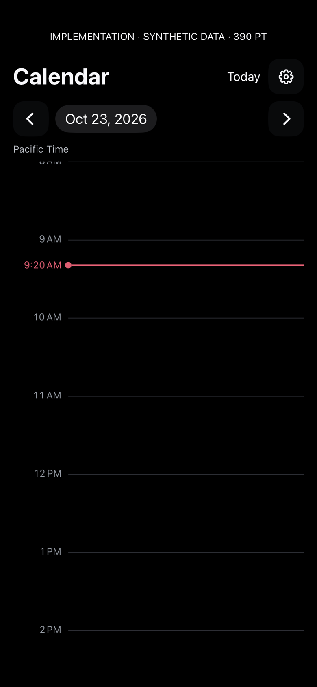
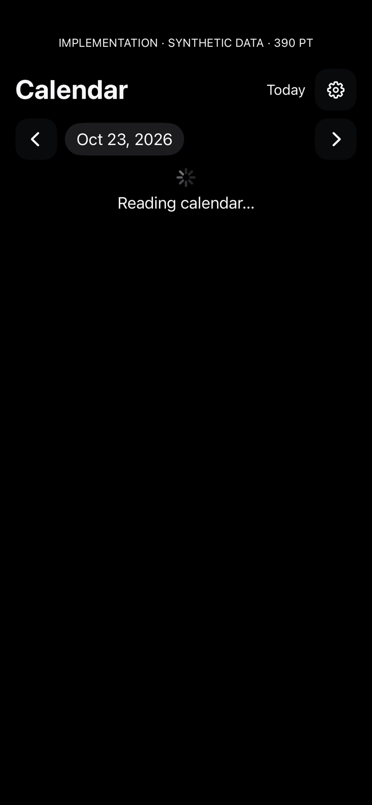
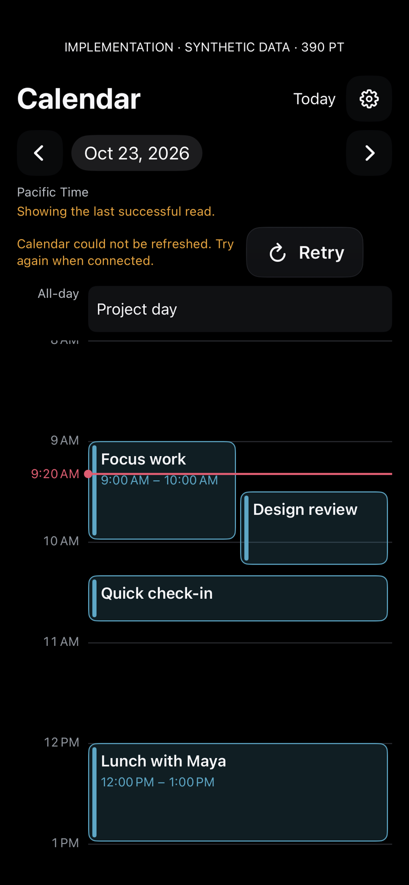
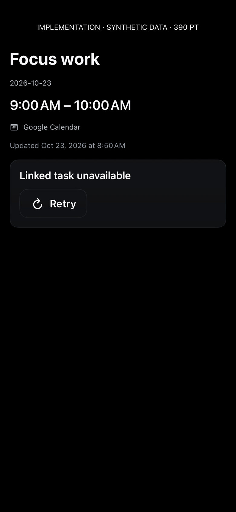

# Calendar timeline implementation — build 516

These are **actual native implementation renders using fictional synthetic data** captured on the physical iPhone. Click each image for its full-size PNG. No private calendar information or credentials are included. The [build 514 gallery](../build-514-v1/README.md) is the agenda-card baseline. The [generated timeline mockup](../../dhoop-calendar-day-timeline-study.png) is a separate design reference, not implementation evidence.

Build 516 widens accessibility event lanes with the text size. Its initial centered horizontal scroll clips the hour gutter; build 517 aligns the same target to the leading edge. This version is retained as the before reference. At narrow widths, event labels truncate visually while the original full title/time remains available to VoiceOver and event details. Native screen content is captured; system navigation chrome, gestures and actual taps are not validated by these renders. Annotation strips are clipped in some tall/tablet captures; each caption below identifies its screen/state/point width. The hour label at the viewport edge can be partially clipped by scrolling.

Repeatable capture (new output directory required):

```sh
Tools/capture-dhoop-calendar-ui.sh CORE_DEVICE_ID docs/design/calendar-implementation/NEW_VERSION
```

## Day timeline · 390 pt · dark · all-day, overlap, current-time line and short event

[](day-390-dark.png)

## Day timeline · 320 pt · narrow dark

[](day-320-dark.png)

## Day timeline · 390 pt · light

[](day-390-light.png)

## Day timeline · 768 pt · tablet-width dark

[](day-768-dark.png)

## Day timeline · 390 pt · accessibility size 3 · BEFORE leading-edge scroll correction

[](day-390-accessibility.png)

## Expanded event/task context · 390 pt · dark

[](detail-390-dark.png)

## Expanded event/task context · 320 pt · narrow dark

[](detail-320-dark.png)

## Verified empty day · 390 pt · dark

[](empty-390-dark.png)

## Initial loading · 390 pt · dark

[](loading-390-dark.png)

## Failed refresh with retained stale day · 390 pt · dark

[](error-390-dark.png)

## Unavailable linked task · 390 pt · dark

[](unavailable-390-dark.png)

## Unconfigured connection · 390 pt · dark

[](connection-390-dark.png)

## Validation and limits

Build 516 passed the iOS Release and macOS app builds and 15 focused Calendar tests. Device inventory confirms installation; existing workout queue/drafts stayed byte-identical. All twelve captures carry a fresh build-516 run UUID and synthetic-only/no-fixture-network flags. The isolated production read passed on October 24: two events, one available linked task, event detail verified, no further page and no writes attempted. The previous shared-client diagnostic race was removed. Fifteen focused tests passed after correcting a fixed-date provisioning fixture exposed at midnight.

Optional human QA: scroll vertically and horizontally on a dense day; tap timed and all-day events; inspect full notes; select another date and Today; check VoiceOver and large-text navigation. These physical interactions were not automated in this capture pass. Calendar/task editing remains in Life.
