# Calendar invitation and Home Screen widget baseline

Actual SwiftUI components rendered on the physical iPhone with build 524, using synthetic data. Each image opens at full size. These are implementation renders, not design mockups or captures of iOS Home Screen chrome.

Repeat: `Tools/capture-dhoop-calendar-invitation-ui.sh CORE_DEVICE_ID docs/design/calendar-invitation-implementation/NEW_VERSION` with an unlocked paired phone. The script is bounded and checks a fresh run identity.

Fixtures use isolated state and no live calendar/nutrition transport or strap writes. They do not establish VoiceOver usability, gestures, actual notification/vibration delivery, or Home Screen placement.

## Pending invitation · 390pt

[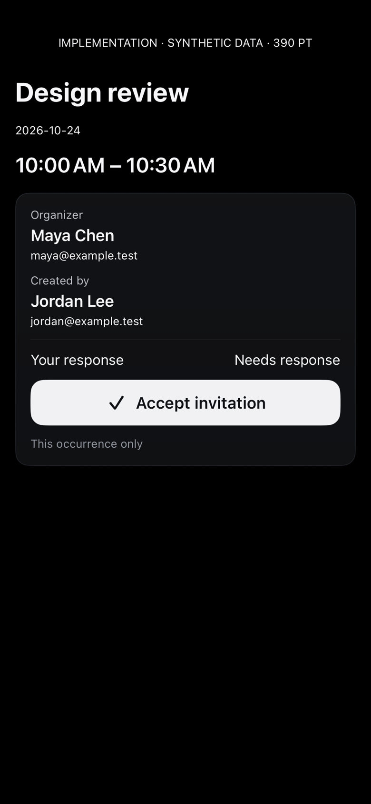](invitation-pending-390.png)

## Pending invitation · 320pt

[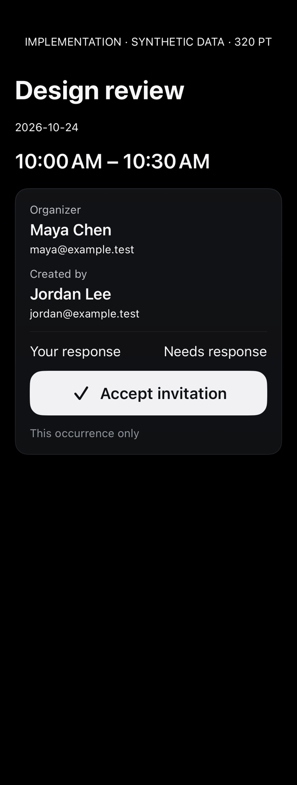](invitation-pending-320.png)

## Light · 390pt

[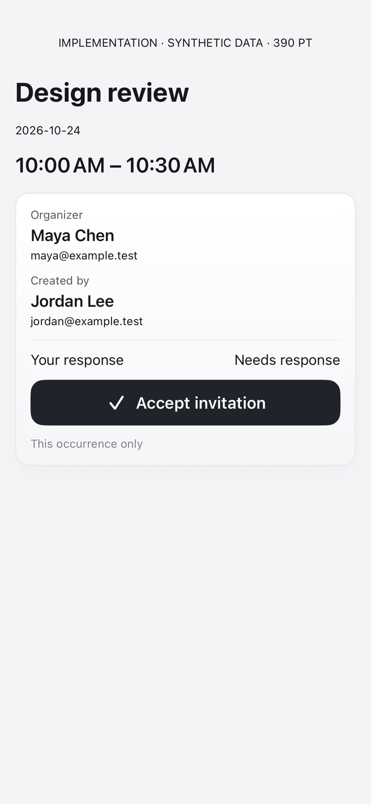](invitation-light.png)

## Accessibility Dynamic Type · 390pt

[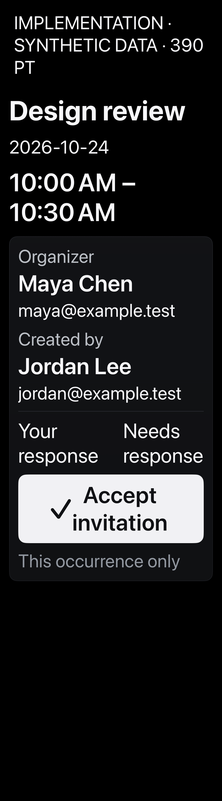](invitation-accessibility.png)

## Accepted state · 390pt

[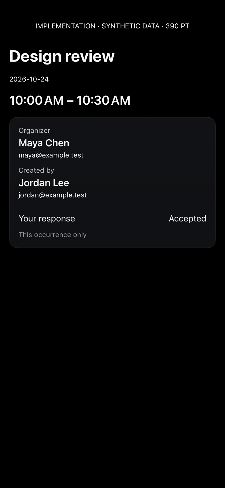](invitation-accepted.png)

## Failed accept · 390pt

[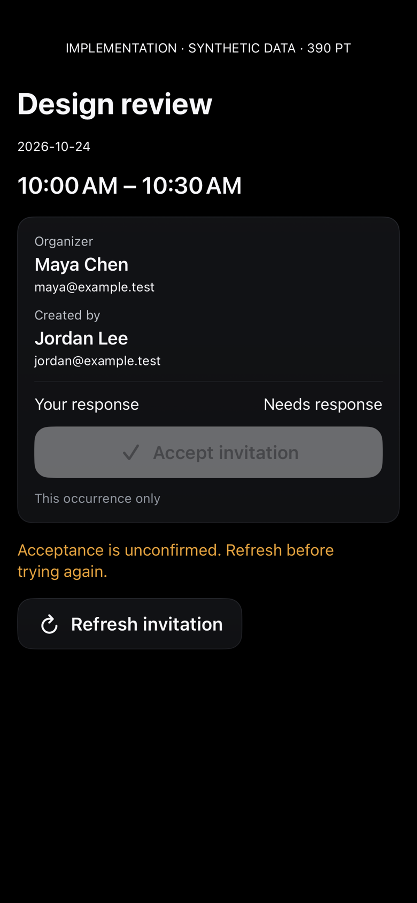](invitation-error.png)

## Setup not activated · 390pt

[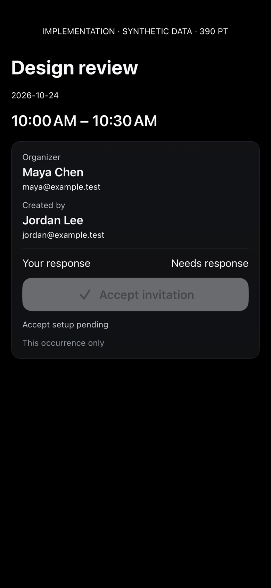](invitation-setup-pending.png)

## Small widget content

[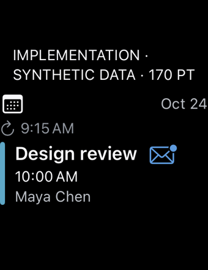](widget-small.png)

## Medium widget content · visible freshness

[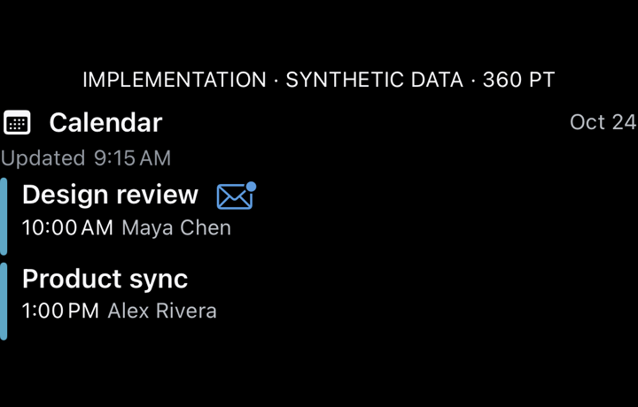](widget-medium.png)

## Large widget content

[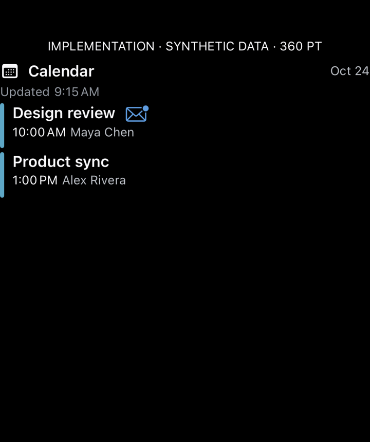](widget-large.png)

## Unavailable widget content

[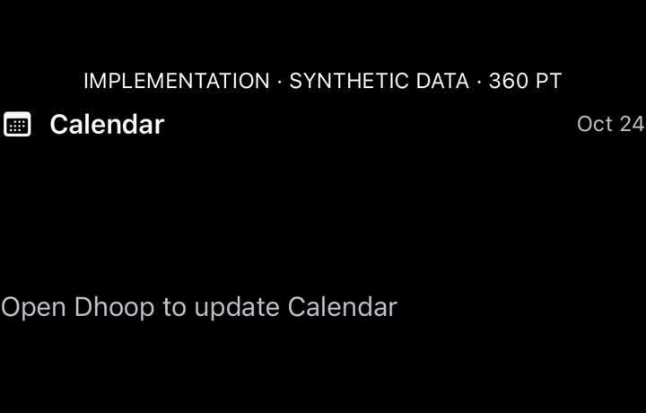](widget-unavailable.png)

The sync time is now directly below the header and visible in the small and medium renders. Intrinsic row heights keep event text from stretching. The failed build-523 scripted attempt is not claimed as a successful capture. RSVP states here are synthetic; live RSVP activation is still pending explicit owner approval.

## Before / after

The preceding [build-520 gallery](../build-520-v1/README.md) is retained for comparison.

[Prior build-521 freshness baseline](../build-521-v1/README.md).
