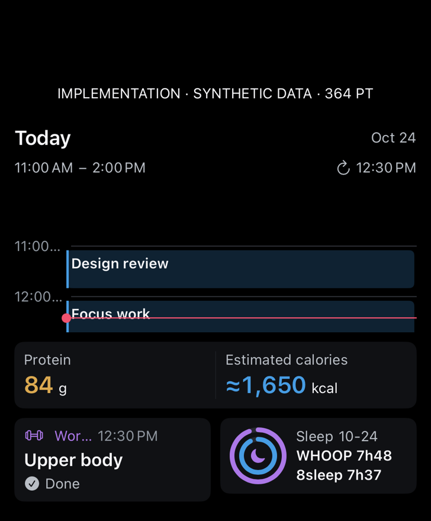
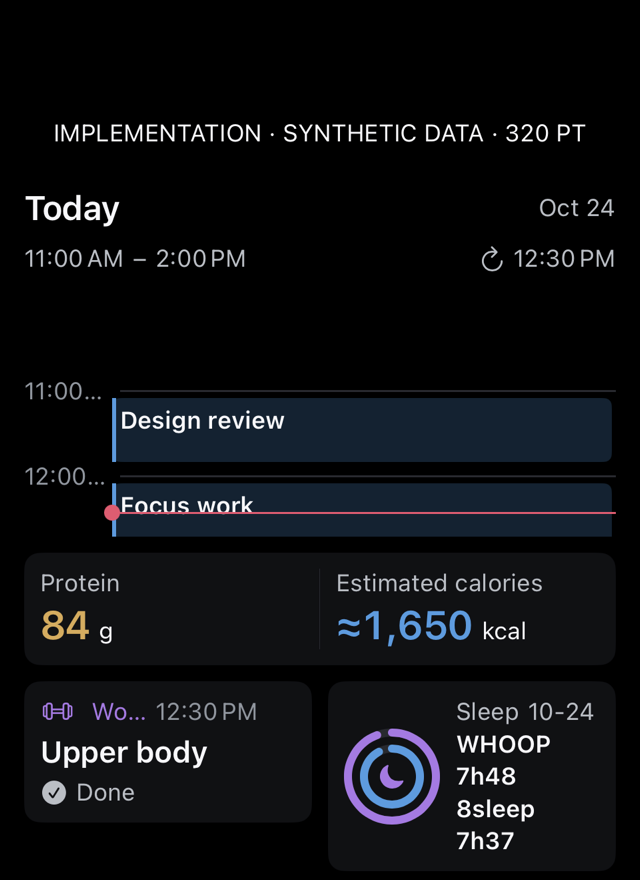
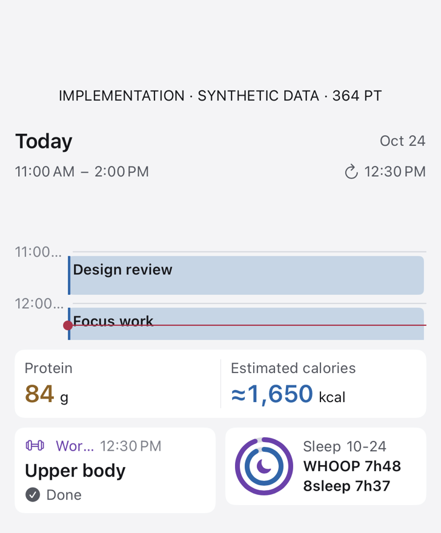
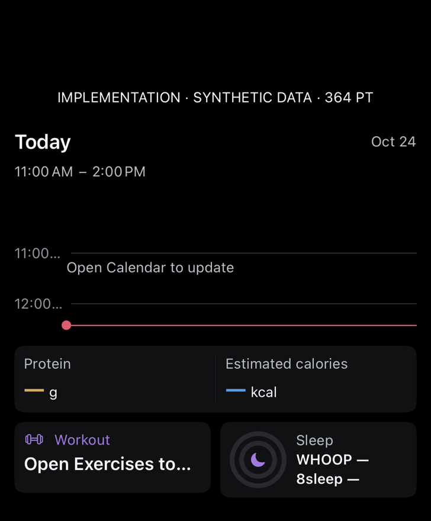
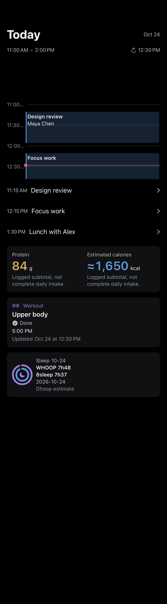
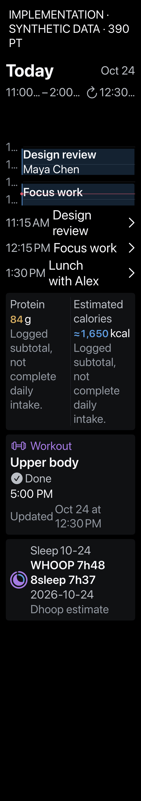

# Day Hub baseline — build 522

Actual components rendered on the physical iPhone with isolated synthetic data. These images are not Home Screen placement screenshots and do not contain owner events, foods or health values. The generated study is [separate](../../dhoop-day-hub-study.png).

This baseline exposed a real SwiftUI alignment error: the plotted future half of the three-hour window was clipped even though the source projection was correct. Axis time labels and the compact workout header also truncated. Build 523 addresses these issues; this baseline is retained for honest before/after review.

## Large widget content · 364pt

[](widget-large.png)

## Narrow stress case · 320pt

[](widget-narrow.png)

## Light widget content · 364pt

[](widget-light.png)

## Unavailable source data · 364pt

[](widget-unavailable.png)

## Full-screen overview content · 390pt

[](overview-390.png)

## Accessibility Dynamic Type · 390pt

[](overview-accessibility.png)

## Repeat capture

```sh
Tools/capture-dhoop-day-hub-ui.sh CORE_DEVICE_ID docs/design/day-hub-implementation/NEW_VERSION
```

The command is bounded and requires a fresh run identity. The fixture uses the actual SwiftUI views with supplied synthetic snapshots; no production test writes. It does not prove physical gestures, VoiceOver use, iOS widget-picker placement, or refresh timing while the phone is suspended. For very short events the full overview also provides normal-size event links below the timeline.
