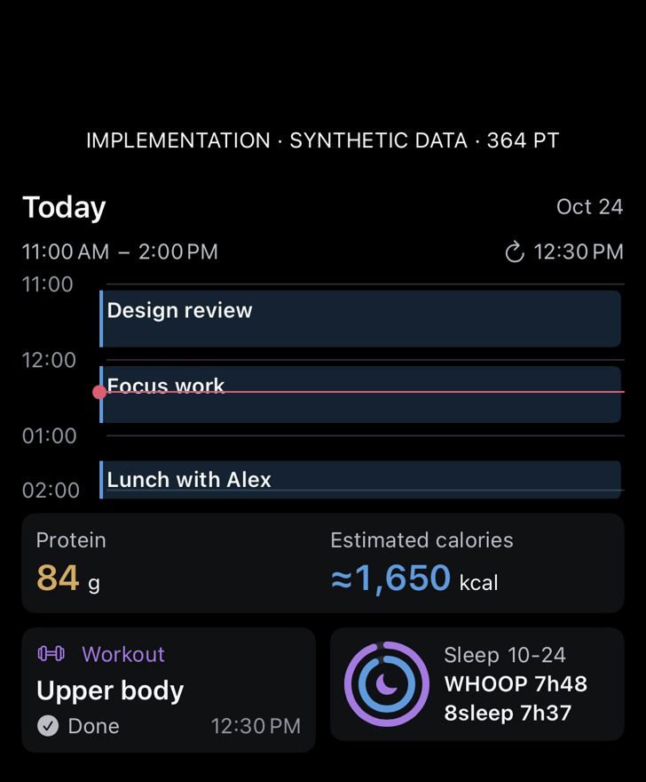
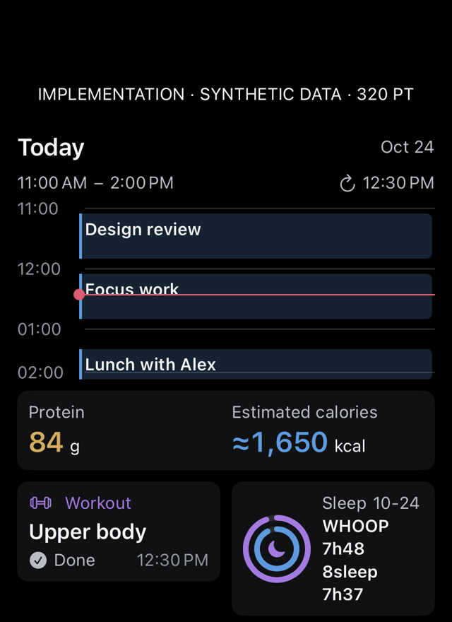
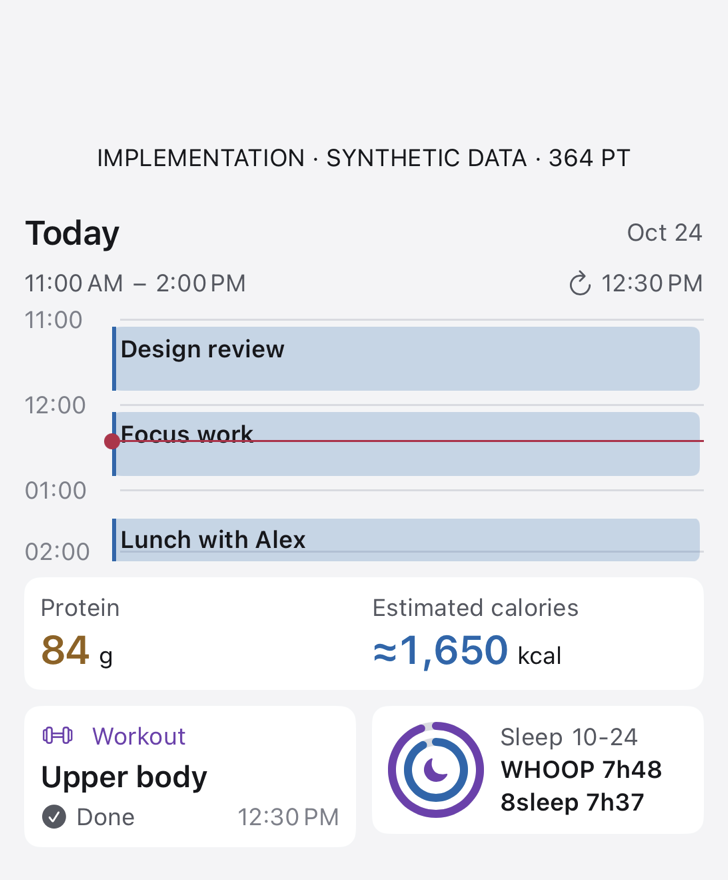
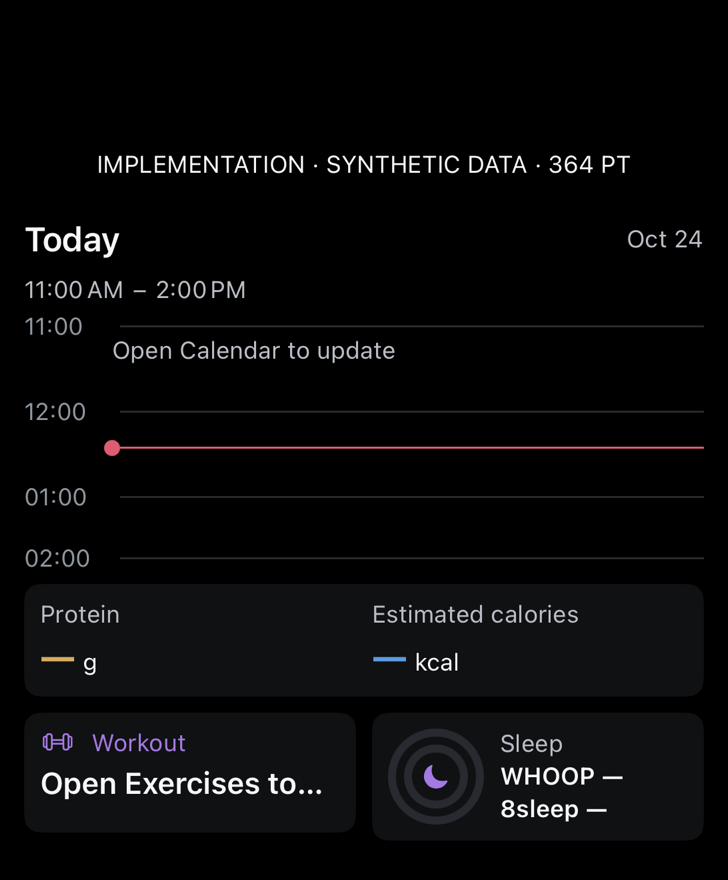
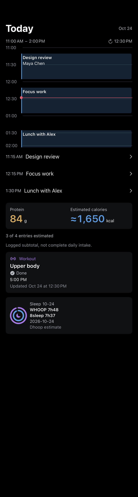

# Day Hub final implementation — build 524

Actual components rendered on the physical iPhone with isolated synthetic data. These images are not Home Screen placement screenshots and do not contain owner events, foods or health values. The generated study is [separate](../../dhoop-day-hub-study.png).

The full three-hour window, past and future events, and current-time line are visible. Large-text nutrition is stacked, the time header wraps, and full-size event links remain available under the timeline. Chart axes stay at the normal plot label size in accessibility layouts; the adjacent time range and event list honor the requested text size. No clipping of the normal-size workout label was observed. Actual Home Screen placement remains unverified; these are component renders.

## Large widget content · 364pt

[](widget-large.png)

## Narrow stress case · 320pt

[](widget-narrow.png)

## Light widget content · 364pt

[](widget-light.png)

## Unavailable source data · 364pt

[](widget-unavailable.png)

## Full-screen overview content · 390pt

[](overview-390.png)

## Accessibility Dynamic Type · 390pt

[](overview-accessibility.png)

## Repeat capture

```sh
Tools/capture-dhoop-day-hub-ui.sh CORE_DEVICE_ID docs/design/day-hub-implementation/NEW_VERSION
```

The command is bounded and requires a fresh run identity. The fixture uses the actual SwiftUI views with supplied synthetic snapshots; no production test writes. It does not prove physical gestures, VoiceOver use, iOS widget-picker placement, or refresh timing while the phone is suspended. For very short events the full overview also provides normal-size event links below the timeline.

[Earlier clipping baseline](../build-522-v1/README.md).

## Before / after review

| Baseline issue | Final result |
| --- | --- |
| Future half clipped in build 522 | Full 11 AM–2 PM window, including the future lunch event. |
| Truncated workout header | Header and dated status remain separate and readable. |
| Two cramped nutrition columns at large text | Stacked metrics, one estimate-coverage line, one subtotal note. |
| Compressed calendar header and plot labels | Wrapping range/freshness header, bounded axes, full-size event links. |

[Build-523 comparison](../build-523-v1/README.md). All labels are synthetic; the screenshot date/time and numbers do not represent owner data.
