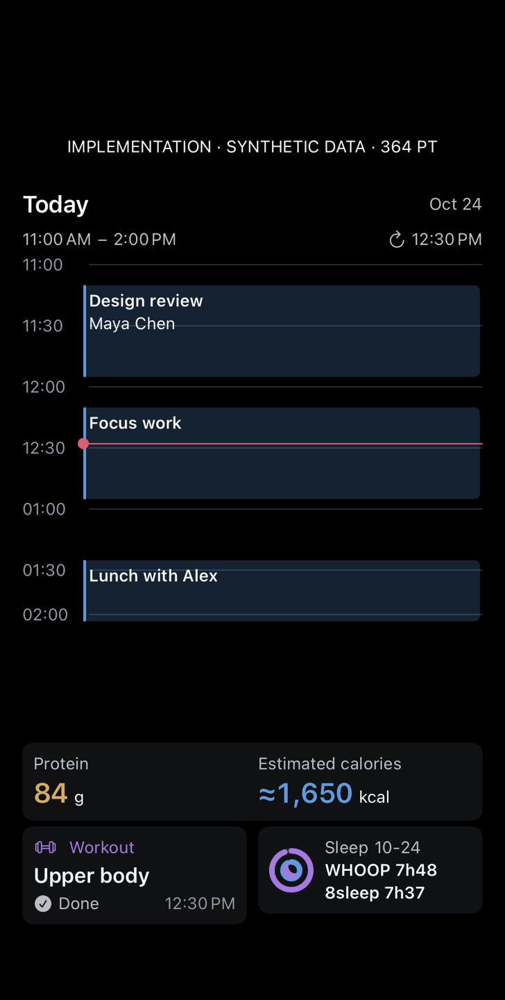
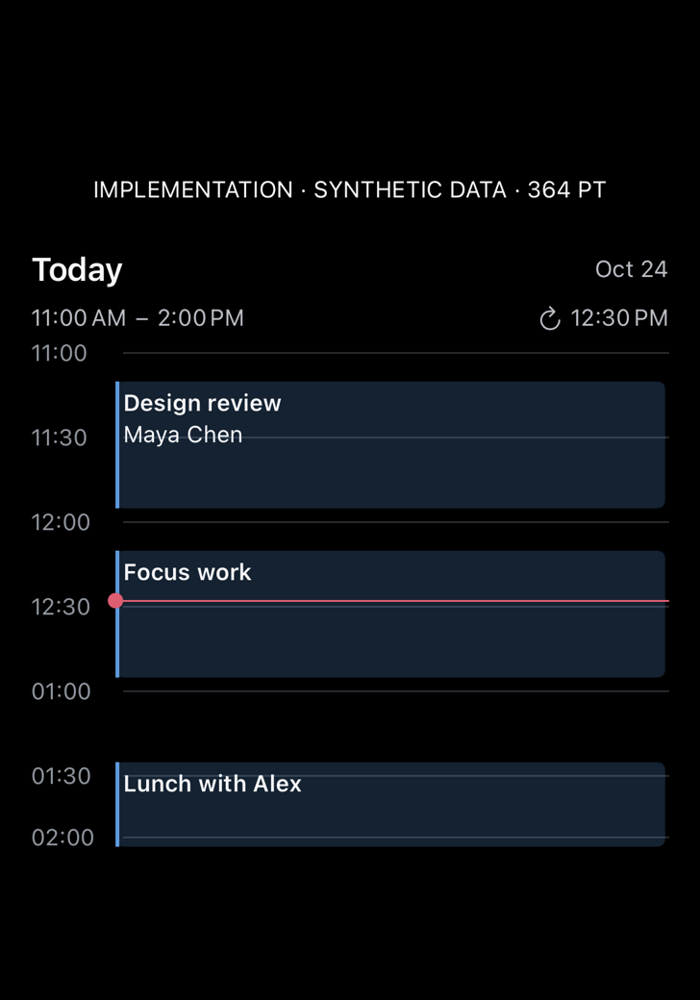
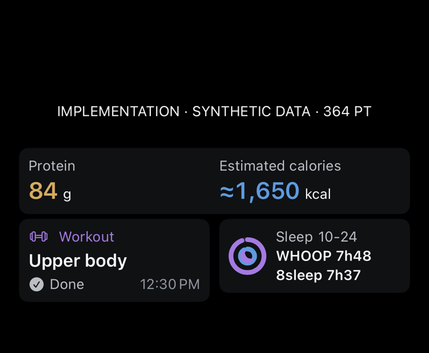
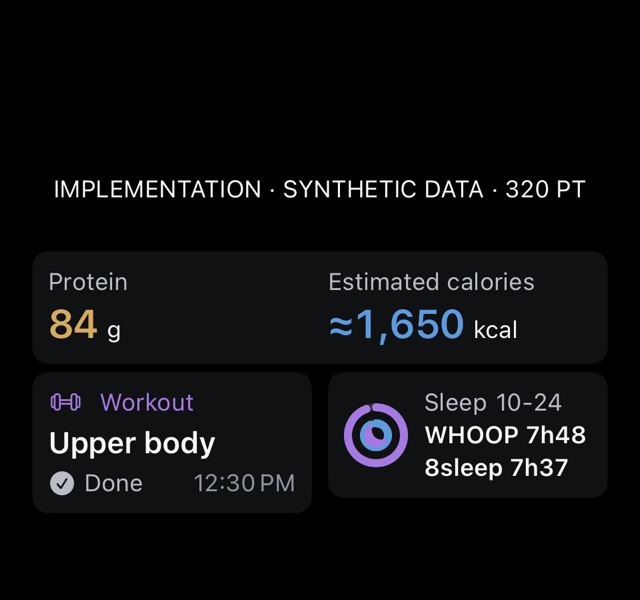
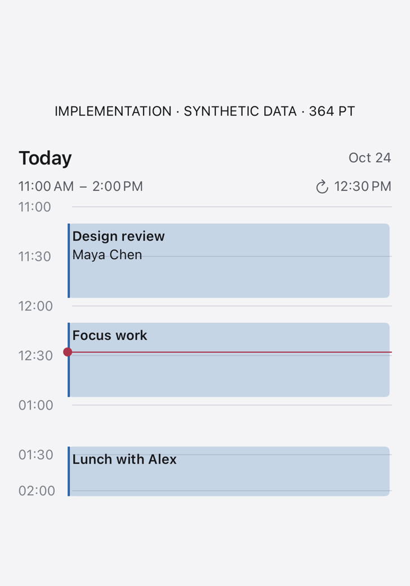
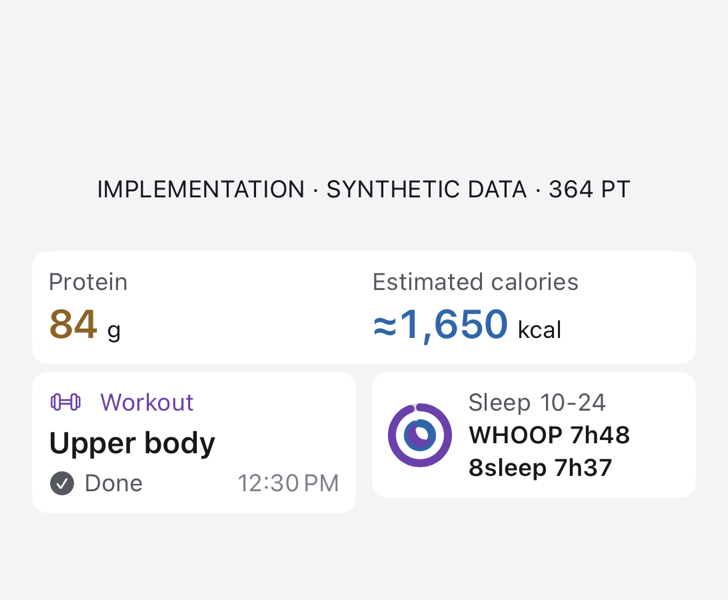
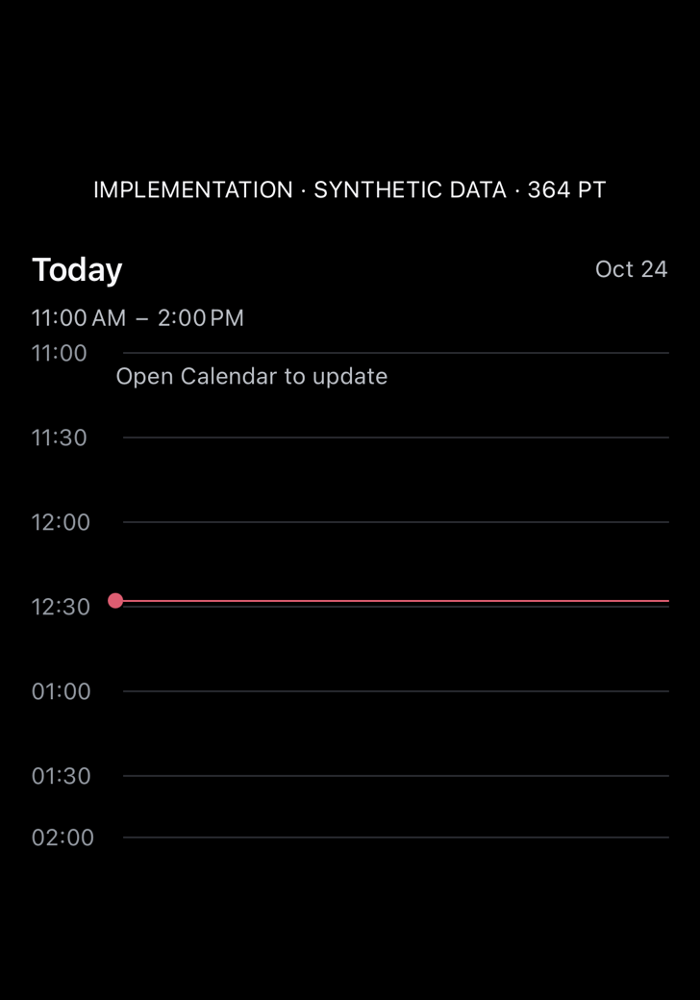
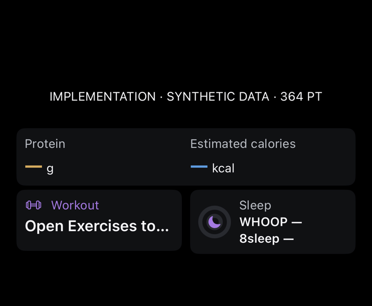

# Dashboard-only widget page — build 526

Actual native component renders from the physical iPhone, using synthetic records. These are not iOS Home Screen placement screenshots. The paired fixtures use the large component footprint (364×382pt) and medium footprint (364×170pt), including an explicit 16pt margin. The 320pt summary is a narrow-layout stress case. WidgetKit controls actual device margins, rounded corners, labels, grid positions and spacing.

## Matched pair

[](paired-stack.png)

| Large Calendar · 364pt | Medium Summary · 364pt | Narrow Summary · 320pt |
| --- | --- | --- |
| [](pair-calendar-large.png) | [](pair-summary-medium.png) | [](pair-summary-narrow.png) |

## Light and unavailable states

| Calendar · light | Summary · light |
| --- | --- |
| [](pair-calendar-light.png) | [](pair-summary-light.png) |

| Calendar · unavailable | Summary · unavailable |
| --- | --- |
| [](pair-calendar-unavailable.png) | [](pair-summary-unavailable.png) |

## Before / after review

| Before | After |
| --- | --- |
| One combined large widget left additional page-grid rows free | Separate large Calendar and medium Summary can occupy the six app-grid rows. |
| Calendar shared its space with metrics | Dedicated 264pt plot, with the same exact ±90-minute bounds and event details. |
| Summary existed only inside the full dashboard | Matching medium presentation reuses the existing food, canonical workout and dated sleep cards. |
| A 48pt sleep ring crowded narrower summary layouts | Summary uses a named 32pt ring token; both provider durations fit at 320pt. |
| Cache publications refreshed only the combined widget | The same publication refreshes all three stable widget kinds; no extra network polling. |
| One widget gallery choice | Two localized paired choices; the previous combined widget remains available. |
| No paired-widget implementation evidence | Native large/medium/narrow, light, unavailable and paired component renders; fresh build/run metadata. |

Widget text has a bounded normal-size layout to fit fixed iOS rectangles; the full-screen app overview retains its Dynamic Type layouts and full-size event links. VoiceOver navigation, actual Home Screen placement and Dock layout were not physically verified. Source data/provenance, day rollover and sleep-cache safeguards are shared with the existing dashboard.

## Repeat

```sh
Tools/capture-dhoop-day-hub-ui.sh CORE_DEVICE_ID docs/design/day-hub-implementation/NEW_VERSION
```

The script has a finite attempt count and rejects stale run IDs. No owner records or credentials enter fixtures. [Generated design study · demo data](../../dhoop-day-hub-pair-study.png) and its [exact prompt](../../dhoop-day-hub-pair-study.prompt.txt) are separate from this implementation gallery. The study used built-in image generation; the image is not a runtime asset.

## Placement on the phone

Add Dhoop → Day Hub Calendar (large) at the top of a dedicated Home Screen page, then Dhoop → Day Hub Summary (medium) below it. Move page icons to other pages or App Library. Apps need not be deleted. The Dock is shared globally and cannot be hidden by these widgets for just one page; it was not changed.
