# Simplified Day Hub widgets — build 527

Actual native component renders from the physical iPhone, using synthetic records only. These are not Home Screen placement screenshots. Combined/Calendar fixtures use a 364×382pt footprint with 16pt margins; Summary uses 364×170pt. Narrow cases use 320pt. Screenshot canvases include the implementation caption and extra surrounding space. WidgetKit controls actual margins, rounded corners and page placement.

## Before / after

| Before · build 526 | After · build 527 |
| --- | --- |
| [](../build-526-pair-v1/widget-large.png) | [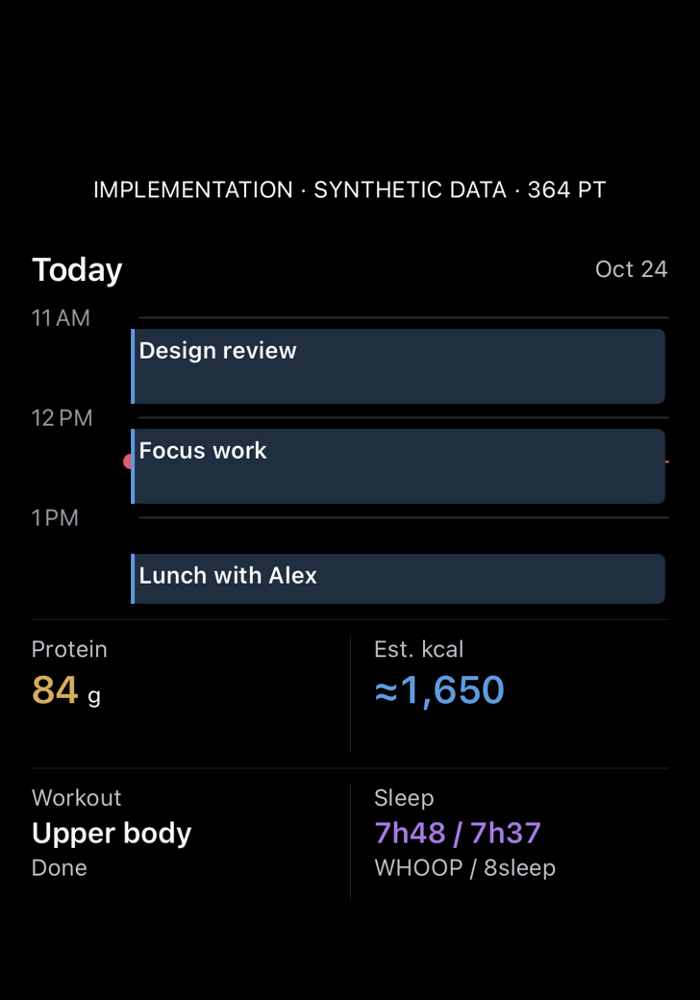](widget-large.png) |
| [](../build-526-pair-v1/pair-summary-medium.png) | [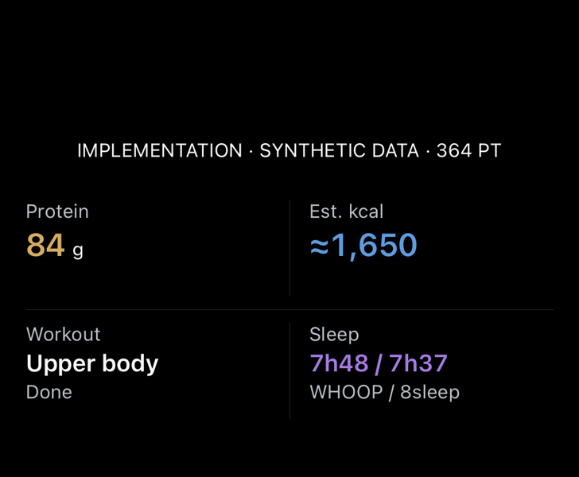](pair-summary-medium.png) |

| Before | After |
| --- | --- |
| Range plus sync row repeated time details | One Today/date header; exact ±90-minute bounds remain in data. |
| Labels started at fractional times and could truncate | Whole-hour labels with a dedicated readable gutter. |
| Red time line crossed event titles | Opaque event surfaces cover the line; the current-time dot remains visible. |
| Nested food, workout and sleep cards | Four flat fields with fine dividers. |
| Compact sleep rings competed with duration text | WHOOP / 8sleep durations shown together, in a consistent order. Older nights retain a date. |
| Long empty-workout and calorie labels | “Not scheduled” requires a complete empty read; “Unavailable” stays distinct. Calories are explicitly estimated. |

## Large and paired widgets

| Combined · 320pt stress case | Calendar · 364pt | Summary · 320pt stress case |
| --- | --- | --- |
| [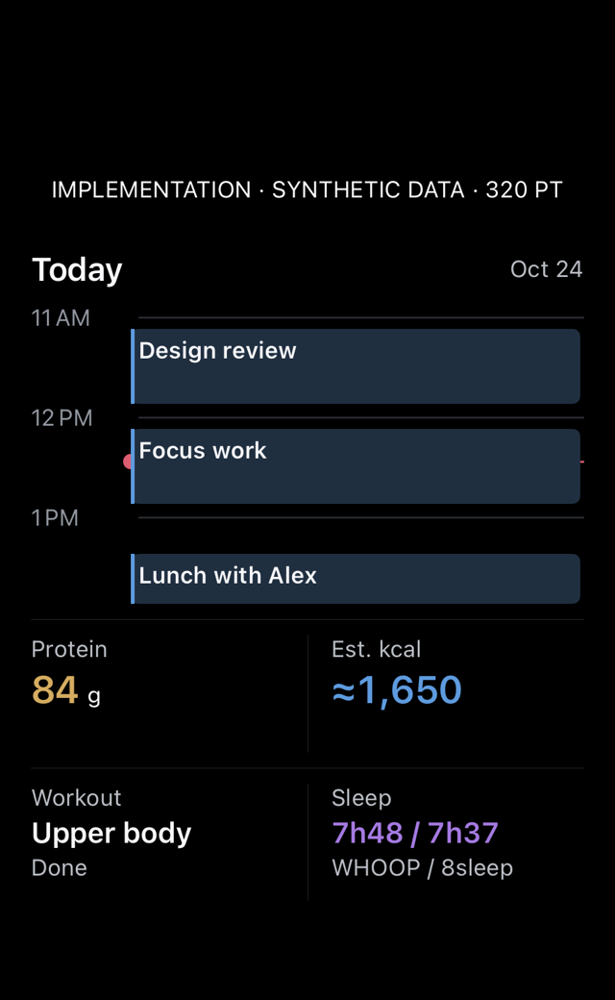](widget-narrow.png) | [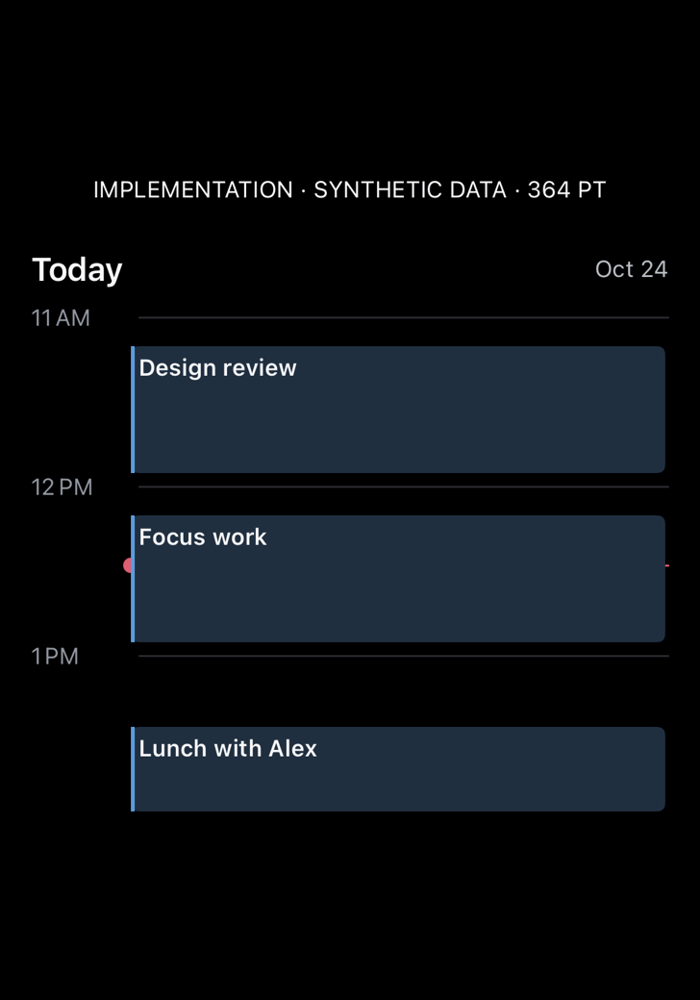](pair-calendar-large.png) | [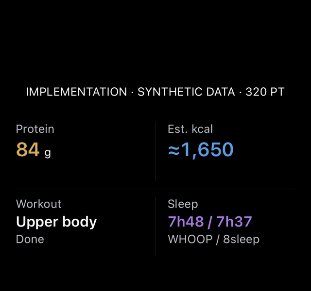](pair-summary-narrow.png) |

[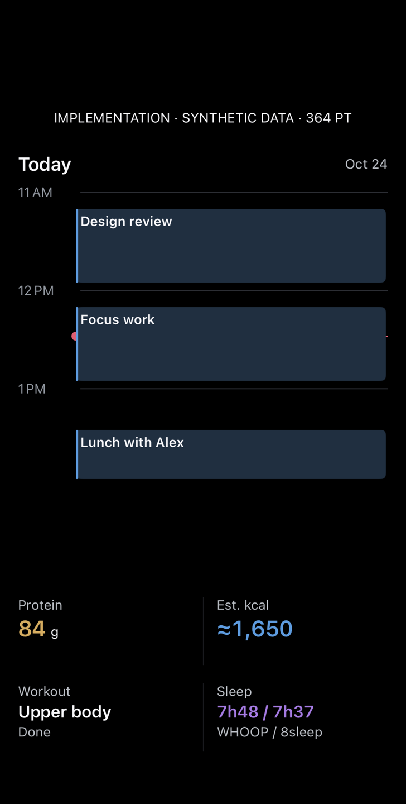](paired-stack.png)

## Missing records and long event title

| Combined unavailable · 364pt | No workout / older partial sleep / long title · 320pt | Summary unavailable · 364pt |
| --- | --- | --- |
| [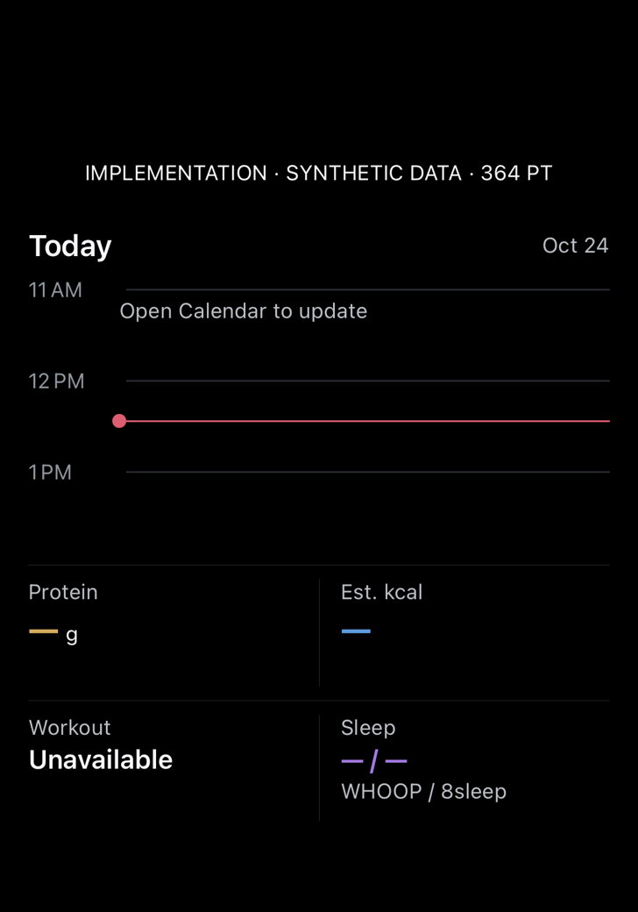](widget-unavailable.png) | [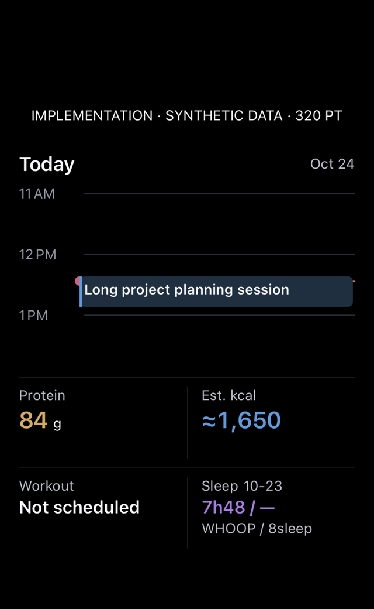](widget-empty-workout-partial-sleep.png) | [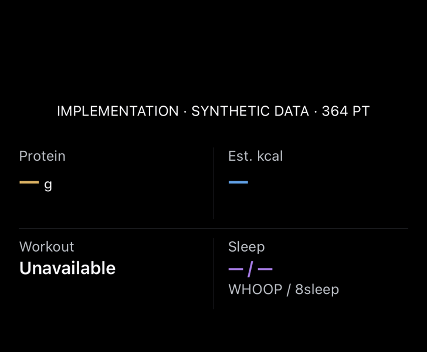](pair-summary-unavailable.png) |

[Calendar unavailable · 364pt](pair-calendar-unavailable.png). No events is asserted only for a complete window; missing calendar reads prompt an update. No invented values, false zero sleep, or inferred workout completion.

## Light mode

| Combined · 364pt | Calendar · 364pt | Summary · 364pt |
| --- | --- | --- |
| [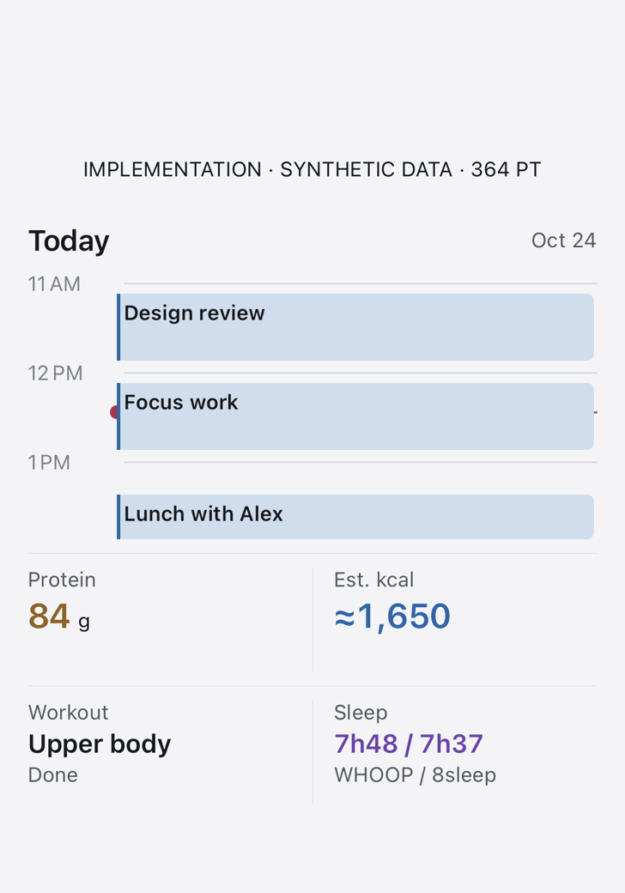](widget-light.png) | [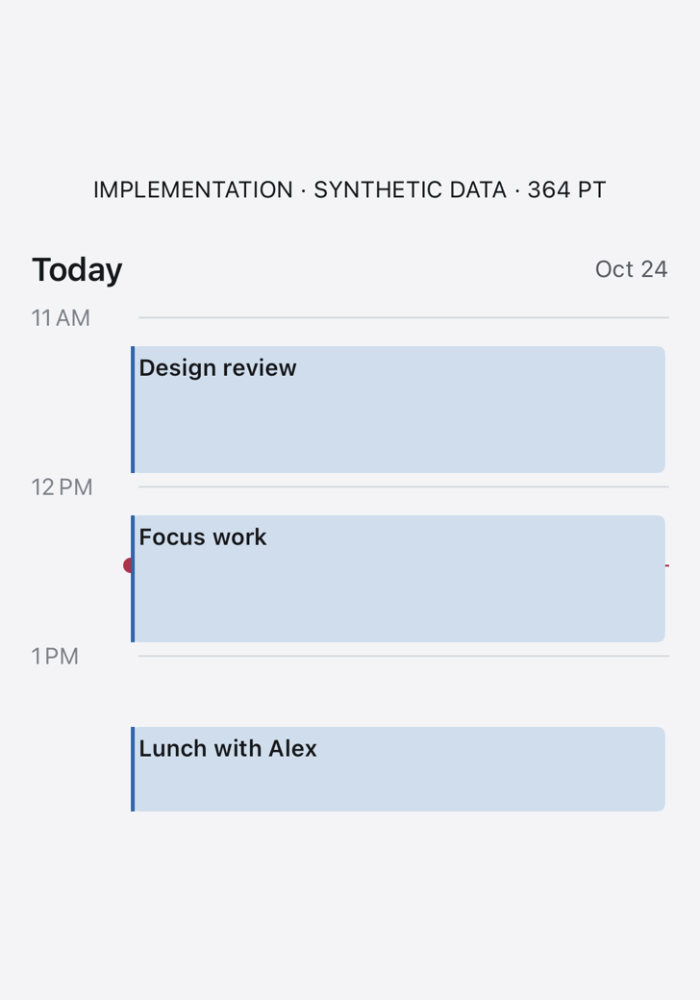](pair-calendar-light.png) | [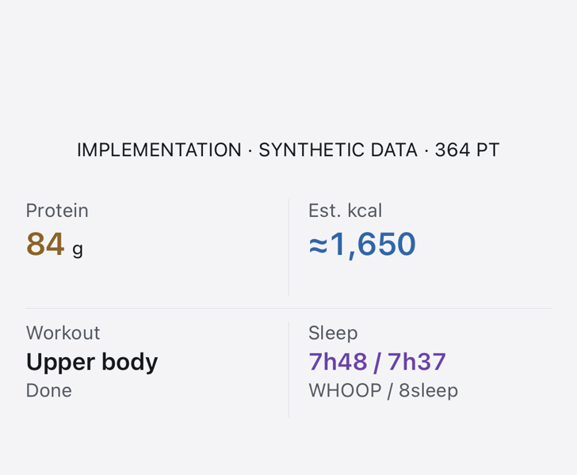](pair-summary-light.png) |

## Linked overview

| Standard · 390pt | Accessibility text · 390pt |
| --- | --- |
| [](overview-390.png) | [](overview-accessibility.png) |

The full overview retains source/read details and scrolling. Widget text remains bounded to fit fixed rectangles. All fonts/colors/spacing use StrandDesign. Physical VoiceOver interaction, actual Home Screen placement and WidgetKit's refresh timing were not verified by these component captures. No simulator was used.

## Validation and repeat

Build 527 passed the iOS Release and macOS builds, all eight targeted DayHub tests, localization and doc-comment gates. Signed app identity and the widget build version were checked before an in-place physical iPhone installation. The new tick test protects the exact off-hour window and distinct elapsed hours through both DST transitions. No analytics, DB schema, credential, source refresh or network behavior changed.

```sh
Tools/capture-dhoop-day-hub-ui.sh CORE_DEVICE_ID docs/design/day-hub-implementation/NEW_VERSION
```

The finite script rejects stale run IDs. [result.json](result.json) records this build/run and confirms synthetic-only captures with no fixture network use. [Generated design study · demo data](../../dhoop-widget-simple-study.png) and [exact prompt](../../dhoop-widget-simple-study.prompt.txt) are separate references. The implementation keeps the vertical calendar instead of copying the mockup's horizontal axis.
