# Health and workout interaction study

Generated with the built-in image generation tool. All photographs, measurements and dates are
fictional. This is a design study, not implementation verification. The app's existing tab structure
is retained; the board's illustrative navigation is not a proposal to replace it.

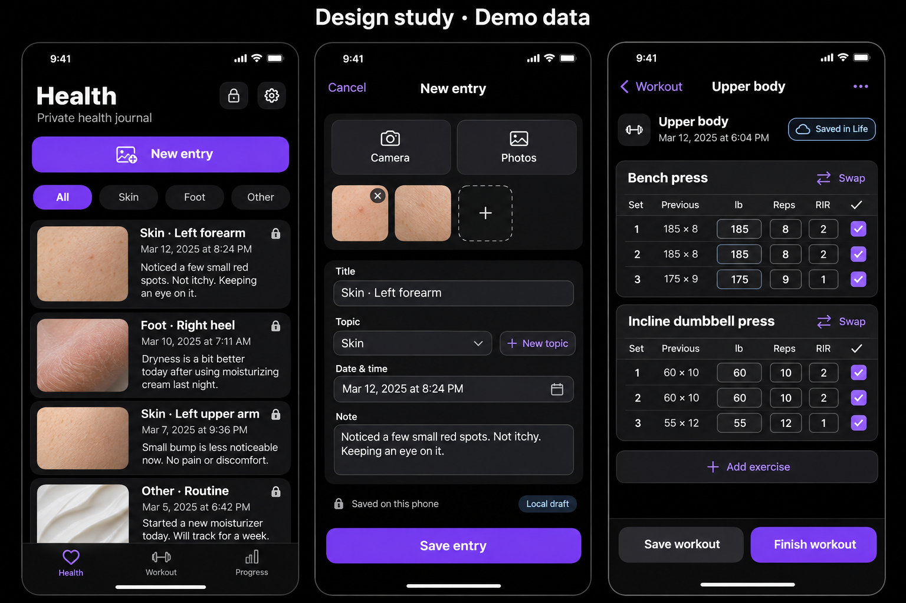

The intended hierarchy is an obvious New entry action, a photo-led private Health timeline, a compact
entry editor and inline workout set rows with clear local/remote save feedback. Use StrandDesign
components and tokens. Actual implementation captures will be labeled separately.

## Actual implementation — workout save flow

These are native iPhone 17 simulator captures on iOS 26.4, 1206 × 2622 pixels. All data is an isolated
synthetic fixture. The design study above is separate from these implementation screenshots.

| Before: Save rejects entered results without a separate Done tap | After: explicit Log action, values retained after relaunch |
| --- | --- |
| [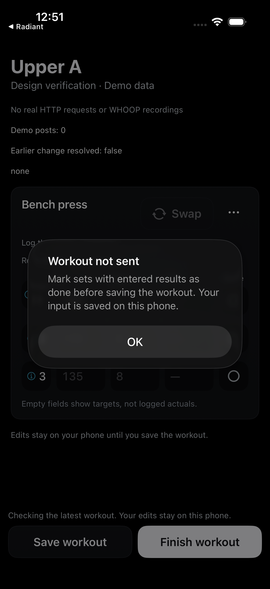](implementation-before/workout-save-requires-done-iphone17.png) | [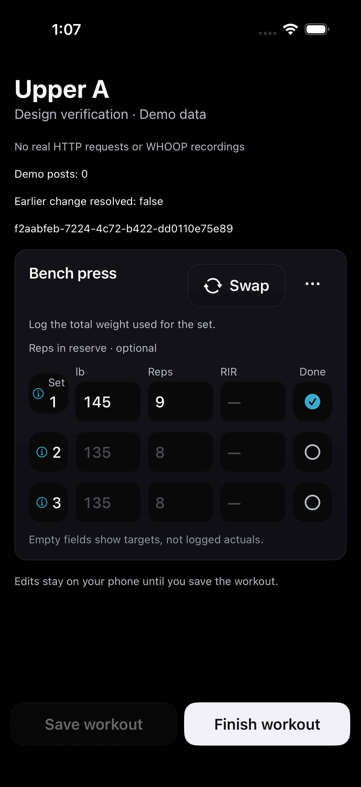](implementation-after/workout-logged-results-relaunched-iphone17.png) |

Repeat the isolated flow using a Debug simulator build:

```sh
xcrun simctl launch SIMULATOR_ID com.devkunjadia.zhoop.loshi.noop \
  --workout-draft-ui-proof --workout-ui-run=NEW_UUID
```

Enter 145 in the first weight field and 9 in repetitions. The button becomes **Log entered sets**;
select it. Verify those exact values, one committed demo operation and untouched unlogged later rows.
Terminate/relaunch the same fixture with the same run UUID to inspect local draft persistence. This
fixture is not a live Life server and is not end-to-end production evidence. Capture the displayed
state with an absolute output path:

```sh
xcrun simctl io SIMULATOR_ID screenshot /absolute/output/workout-state.png
```

The real UI was inspected using computer use. Narrow-screen, accessibility, delay/offline scenarios,
Lower workflows, the Health redesign and physical-device evidence remain separate pending checks.


## Actual implementation — Health build 535

Native SwiftUI renders with isolated synthetic data. Widths are logical points; images are at 2×.
The generated forearm is fictional, created with imagegen for this fixture (SHA-256
`00510a9d51f35799304c12da9d7179032e28ae789d6146add4d9b8ab79348157`). No owner photo,
credential or medical record is included. Original-file storage is unchanged; thumbnails are
in-memory downsampled previews. These captures verify layout, not production delivery.

| Timeline · dark · 390pt | First entry · 390pt |
| --- | --- |
| [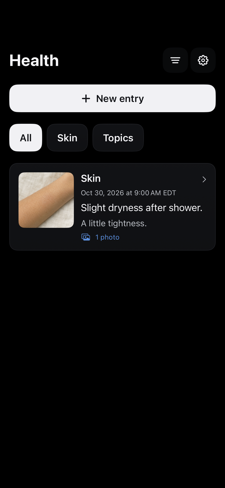](implementation-health-535/timeline-dark-390.png) | [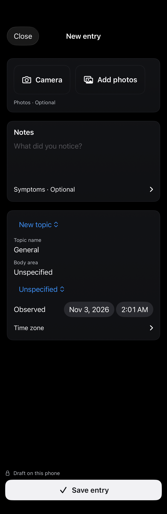](implementation-health-535/first-entry-390.png) |

| Light · 390pt | Narrow · 320pt | Accessibility3 · 390pt |
| --- | --- | --- |
| [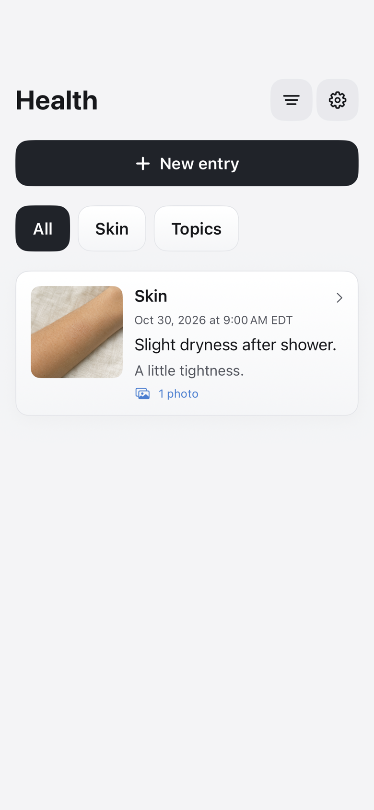](implementation-health-535/timeline-light-390.png) | [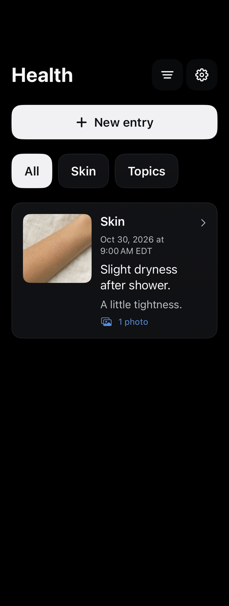](implementation-health-535/timeline-narrow-320.png) | [](implementation-health-535/timeline-accessibility.png) |

| Detail · 390pt | Editor · 390pt | Empty · 390pt | Error · 390pt |
| --- | --- | --- | --- |
| [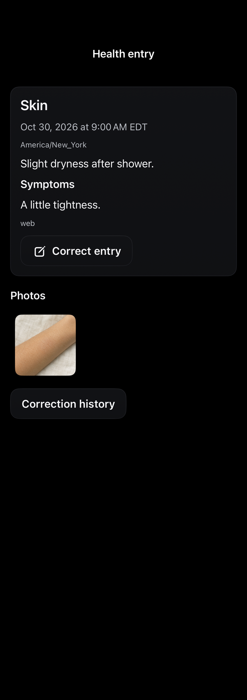](implementation-health-535/detail-390.png) | [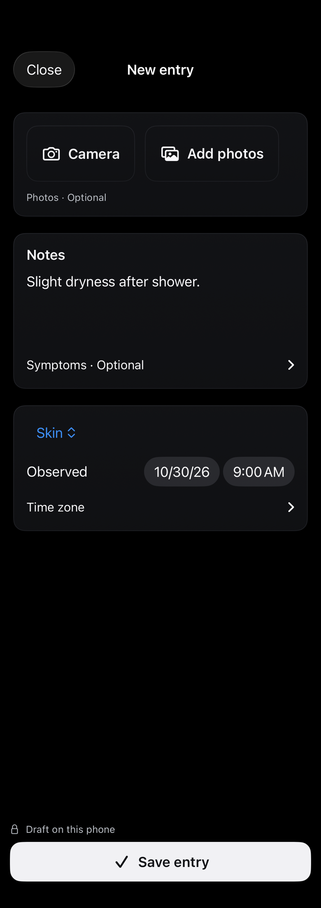](implementation-health-535/editor-390.png) | [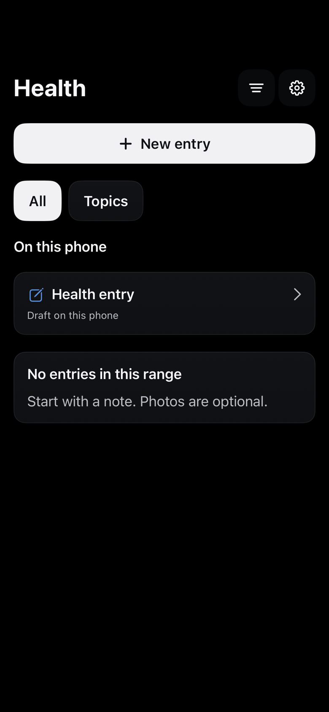](implementation-health-535/empty-390.png) | [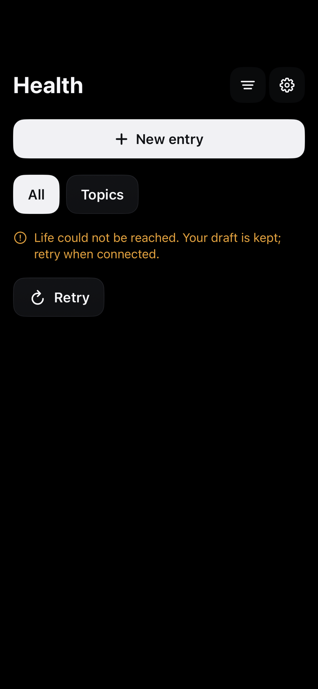](implementation-health-535/error-390.png) |

Repeat using a Debug simulator build and the pinned demo photo copied into its data container's
`tmp/health-journal-demo.png` (the fixture rejects a mismatched digest):

```sh
xcrun simctl launch SIMULATOR_ID com.devkunjadia.zhoop.loshi.noop \
  --health-journal-ui-proof --health-journal-render-proof --health-render-run=NEW_UUID
```

Captures and the run/build manifest are written to the app data container's `tmp/dhoop-health-ui-v1`.
Use `xcrun simctl get_app_container SIMULATOR_ID com.devkunjadia.zhoop.loshi.noop data` to locate them.
For interactive checks use `--health-journal-ui-proof --health-ui-run=NEW_UUID`; add
`--health-ui-empty`, `--health-ui-offline` or `--health-ui-slow` for those states. Fixtures never use
HTTP or production credentials. Optional `--health-ui-seed-photo` prepares the known demo image
through the public draft attachment API; this is not evidence of PhotosPicker selection.

Verified: 29 Health contract/client/storage tests, 130 StrandDesign tests, simulator iOS and macOS
app builds, translation audit, and the renders above. Interactive New entry/typing was inspected
before the Mac locked. System photo selection, camera capture, complete interactive save flow,
keyboard/loading captures and physical-device Health checks remain pending.


## Actual implementation — reusable exercises, build 535

| New exercise · 390pt | Narrow · 320pt |
| --- | --- |
| [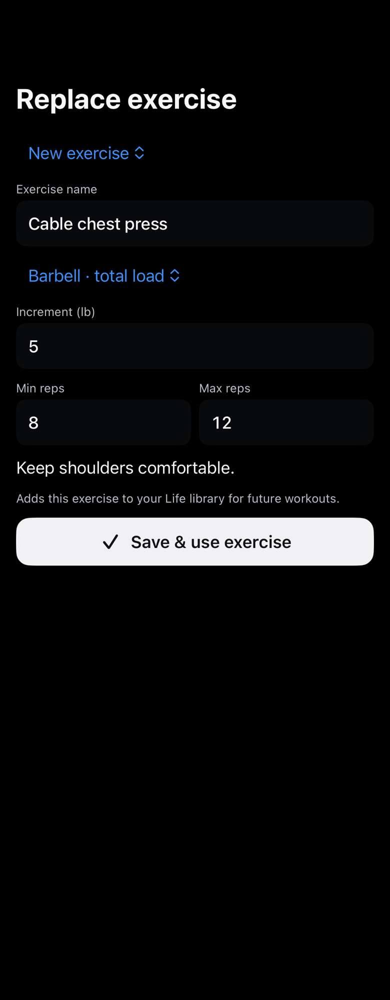](implementation-workout-535/custom-390.png) | [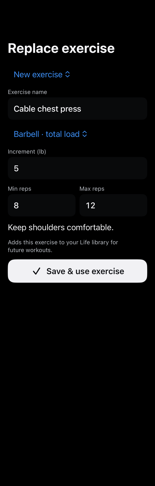](implementation-workout-535/custom-320.png) |

These native synthetic renders show the shared replacement component. The equipment choice is
explicit owner input, not inferred from the exercise name. Library selection and new exercise
creation use the same Life substitution action, gated by its separate capability. Entered definitions
are retained locally and normalized only when an explicit Save freezes the immutable request.
Completed sets remain historical work; eligible future workouts use the replacement.

| Previous behavior | Updated behavior |
| --- | --- |
| A custom name changed only this workout's display label | Swap can create an explicit reusable catalog exercise |
| An interrupted editor sent the owner to connection settings | Retry recovers the same operation before replay; rejected changes require review |
| Reopening a screen repeated permission checks | Screen reads reuse a verified check for 60 seconds; concurrent reads coalesce |

Repeat the native component captures with an isolated Debug simulator build:

```sh
xcrun simctl launch SIMULATOR_ID com.devkunjadia.zhoop.loshi.noop \
  --workout-draft-ui-proof --workout-replacement-render-proof --workout-ui-run=NEW_UUID
```

Files are in the app data container's `tmp/dhoop-workout-replacement-ui`. A fresh run UUID isolates the
workout fixture. The replacement renders use a separate fresh synthetic connection and no HTTP.
`--workout-ui-slow` delays the fixture's write response by 2 seconds for interactive checks.
Do not use production owner data in screenshots.

Current targeted regression run: 69 tests passed (29 Health, 19 workout command/client, 21 workout
draft). This includes three successive Upper and Lower model workflows each, with save, finish,
reopen, relaunch, retained aliases, untouched unlogged sets, offline receipt recovery and conflicts.
A new capability-read regression failed before the fix because the second caller received
`disabled`; it passes after coalescing. Thirty durable model edits took 9ms total with zero HTTP
requests in the latest Mac run. This does **not** measure visible tap latency or the iPhone.

The coordinated Life Health deployment reported authenticated read-only capability and limit-one
entry reads passing with `inlineTopicCreation:true`. One finite Mac CLI repeat measured 774ms and
113.5ms respectively; these are single end-to-end request samples, including connection/network
work, not server-only or iPhone timings. No owner workout or Health test writes were performed.
Interactive swap/create, keyboard/delay/loading states, VoiceOver navigation, 30 visible interactions
and physical-phone verification remain required before the full goal can be declared complete.


## Build 536 reliability follow-up

The Save reader now uses an independent exact-session GET instead of the tracker's shared mutation
lock and broader dashboard cache. A regression reproduced `deliveryInProgress` while an unrelated
read held that lock; after the fix the Save reader returns its own verified revision and leaves the
other cache unchanged. The screen refresh uses the same scoped read and retains its corresponding
exercise library. The layout is unchanged from the labeled build-535 captures above.

All 76 selected regressions passed: Health 29, command/client 19, workout draft 22, dashboard 6.
A real two-second asynchronous response fixture kept 30 durable local edits available without a
second submission; newer values survived relaunch after the original save completed. Model-edit
p95 was 0.437333ms on the Mac test runner. This is not visible UI or physical-phone timing.

Authenticated read-only Life MCP checks also verified one active lifting program, the next session,
and an existing completed session with stored actual results. Completed/total summary counts matched
the detail, and set identities were unique. No private values are published in the sanitized
[read proof](../../verification/dhoop-536-mcp-reads.json); no mutation tools were called.

Build 536 was signed, installed in place and version-verified on the physical iPhone. The fresh probe
could not launch because iOS reported the phone locked. Mac simulator control is also blocked by the
Mac lock screen. Remaining interactive/physical gates from build 535 still apply; the full goal is
not complete. See [build-536 readiness](../../verification/dhoop-536-readiness.json).
