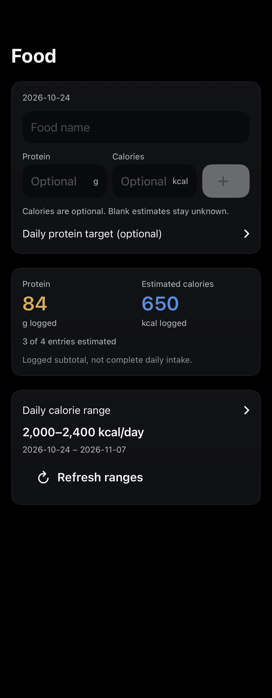
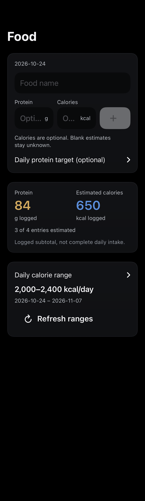
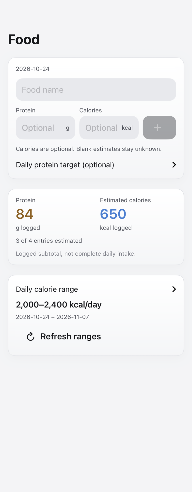
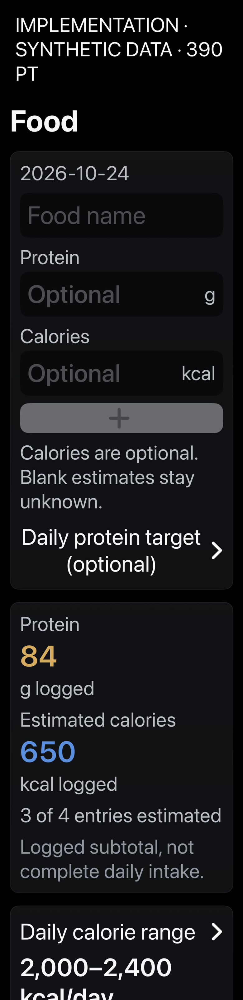
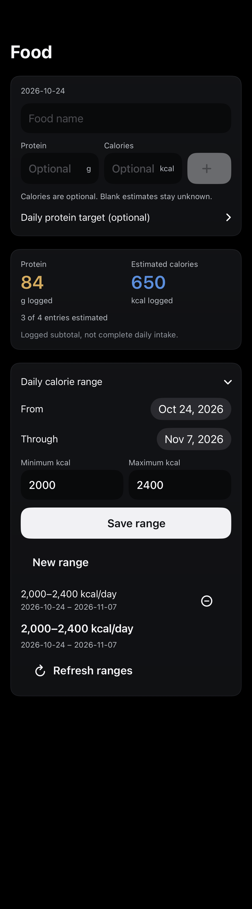
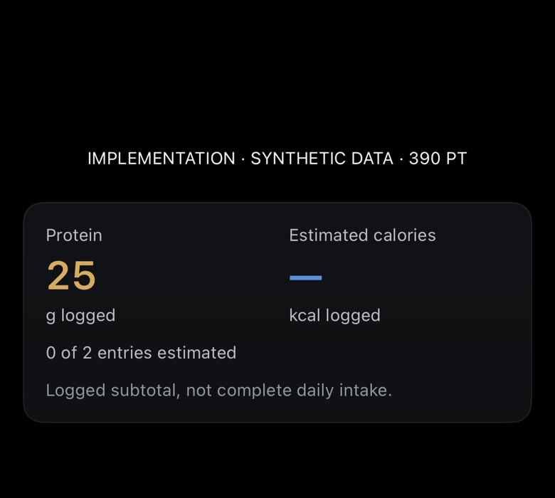
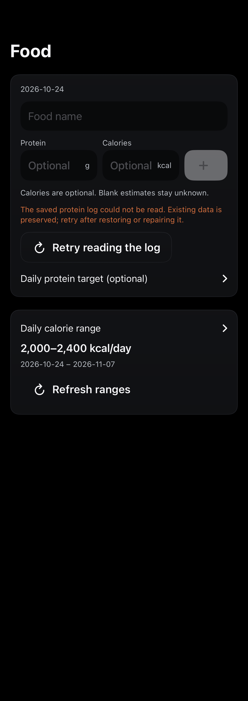

# Food log baseline

Actual SwiftUI components rendered on the physical iPhone with build 520, using synthetic data. Each image opens at full size. These are implementation renders, not design mockups or captures of iOS Home Screen chrome.

Repeat: `Tools/capture-dhoop-food-log-ui.sh CORE_DEVICE_ID docs/design/food-log-implementation/NEW_VERSION` with an unlocked paired phone. The script is bounded and checks a fresh run identity.

Fixtures use isolated state and no live calendar/nutrition transport or strap writes. They do not establish VoiceOver usability, gestures, actual notification/vibration delivery, or Home Screen placement.

## Food · 390pt

## Food · 320pt · baseline placeholder truncation

## Food · light · 390pt

## Accessibility Dynamic Type · 390pt

## Expanded dated calorie range · 390pt

## Unknown calorie estimates · 390pt

## Unreadable storage · 390pt

The first scripted food capture did not produce a result. The successful bounded console relaunch and fresh run identity are recorded in result.json; no failed attempt is represented as successful. Narrow placeholders and repeated expanded-goal copy were refined after this baseline.
