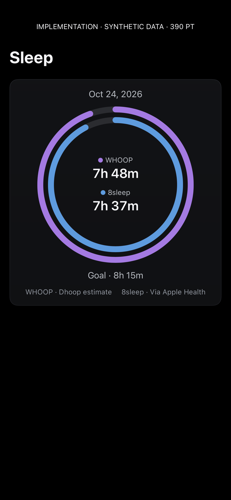
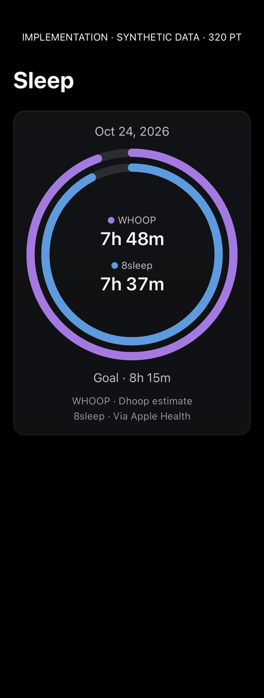
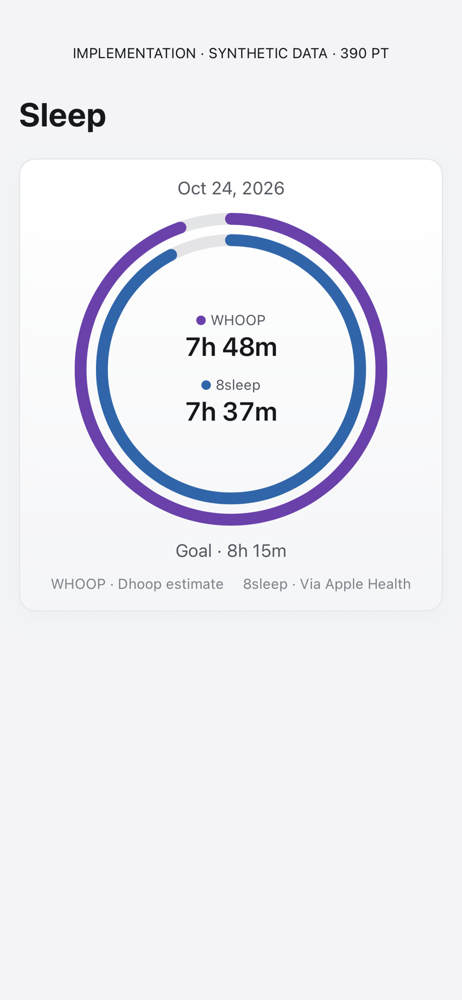
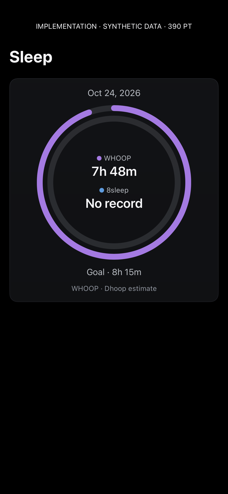
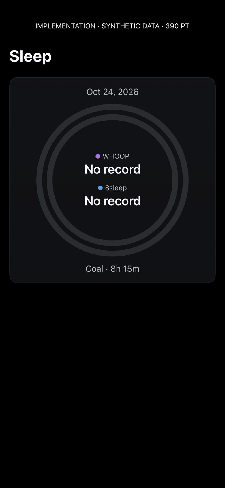
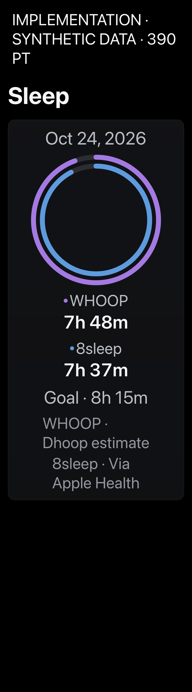

# Combined sleep comparison rings

Actual SwiftUI components rendered on the physical iPhone with build 520, using synthetic data. Each image opens at full size. These are implementation renders, not design mockups or captures of iOS Home Screen chrome.

Repeat: `Tools/capture-dhoop-sleep-comparison-ui.sh CORE_DEVICE_ID docs/design/sleep-comparison-implementation/NEW_VERSION` with an unlocked paired phone. The script is bounded and checks a fresh run identity.

Fixtures use isolated state and no live calendar/nutrition transport or strap writes. They do not establish VoiceOver usability, gestures, actual notification/vibration delivery, or Home Screen placement.

## Dark · 390pt

## Narrow · 320pt

## Light · 390pt

## Missing 8sleep record · 390pt

## No records · 390pt

## Accessibility Dynamic Type · 390pt

